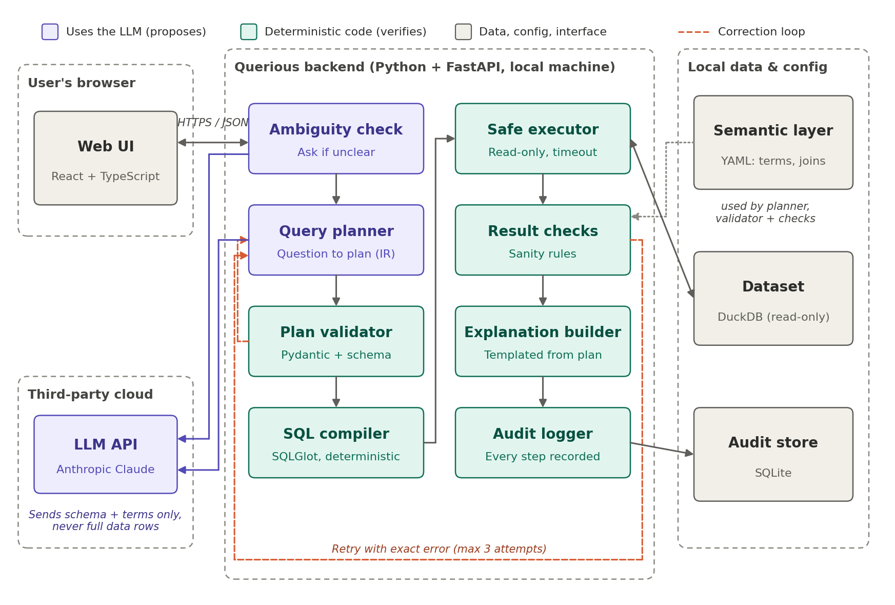

# Querious AI — Architecture

> **Read this before working on any Issue.** It holds the long-lived technical structure that every Issue must respect.
> Product rules, roles and terminology are in [POLICY.md](POLICY.md). Direction and phases are in [ROADMAP.md](ROADMAP.md). Tasks, order and status are in the [GitHub Project](https://github.com/users/chepkemboiedel-sudo/projects/4). The full rationale is in the SDD (`docs/design/`) and the Implementation Plan (`docs/plan/`).
>
> Owner: Edel Kiprop · Last reviewed: November 2026 · Changing a rule marked 🔒 needs an ADR (Section 8).

## 1. The idea in one line

**The AI suggests, the system checks.** The LLM has exactly two jobs: spot ambiguity, and draft a structured query plan. Deterministic, testable code decides what runs and what the user sees. (DD-01)

## 2. Components



| Component | Responsibility | Code location | LLM? |
|---|---|---|---|
| Web UI | Screens 1–10 (Figure 2). Talks only to the backend API. | `frontend/` (React + TS, Vite, Recharts) | No |
| API | HTTP endpoints, stage progress, request/response models. | `backend/app/api/` | No |
| Ambiguity check | Decides whether a question needs clarification and offers 2–3 schema-valid meanings. | `backend/app/pipeline/ambiguity.py` | **Yes** |
| Query planner | Turns the question into a JSON query plan (IR). | `backend/app/pipeline/planner.py` | **Yes** |
| Plan validator | Pydantic schema, schema/term/join checks, capability gate, risk classifier. | `backend/app/pipeline/validator.py`, `risk.py` | No |
| SQL compiler | IR → one `SELECT` with SQLGlot. Same plan always gives the same SQL. | `backend/app/pipeline/compiler.py` | No |
| Safe executor | The only code that runs SQL. Read-only DuckDB, 15 s timeout, 5,000 rows. | `backend/app/pipeline/executor.py` | No |
| Result checks | Sanity checks plus the risk-specific check registry. | `backend/app/pipeline/checks/` | No |
| Trust, provenance, explanation | RC-17 trust level, RC-19 provenance, templated summary, follow-up templates. | `backend/app/pipeline/trust.py`, `provenance.py`, `explain.py`, `followups.py` | No |
| Audit logger | Append-only events in SQLite. History and replay read from here. | `backend/app/audit/` | No |
| LLM provider interface | The **only** module that imports a model SDK. Ships with a mock provider for tests. | `backend/app/llm/` | Calls the API |
| Semantic layer | Business terms, metrics, allowed joins, **grouped per dataset**. The active dataset's section is validated each time that dataset becomes active. | `semantic_layer.yaml` | No |
| Evaluation | Gold set runner (US-13). Optional isolated baseline runner (US-14). | `eval/` | Only through the provider |

## 3. How a question flows

```text
Ask ─► Ambiguity check ─┬─ ambiguous ─► Clarify (user picks; nothing has run)
                        └─ clear ─► Planner ─► Validator (+capability gate, risk class)
                                      ▲            │ invalid → exact error
                                      │            ▼
                                      ├──── Preview (operations + risk) to the browser
                                      │            ▼
                                      │       Compiler ─► Executor ─► Result checks
                                      │                                  │ failed → exact error
                                      └──── retry (max 3 planning attempts) ◄┘
                                                   ▼ passed
                           Trust level + provenance + templated summary + follow-ups
                                                   ▼
                                Answer (screen 6) + evidence cards (screen 7)
Every step above writes an audit event. After attempt 3 fails → honest failure (screen 8), no number.
```

## 4. Allowed relationships

The arrows show who may call or import whom. Anything not listed is not allowed.

- `frontend` → `backend/app/api` only, over HTTP/JSON. The browser never sees SQL before it runs, and never sees the API key.
- `api` → `pipeline`, `audit` (read only, for history and replay).
- `pipeline` → `llm` (only `ambiguity` and `planner`), `audit` (write), the semantic-layer loader and the executor.
- The dataset **loader** writes the active dataset's DuckDB file once, at load time. After that, `executor` is the only module that opens it, and always read-only. `audit` is the only module that opens SQLite.
- `llm` imports nothing from `pipeline`. It receives a prompt payload and returns text or JSON.
- `eval/` may import `pipeline` and `llm`. Nothing imports `eval/`. The baseline runner (US-14) is never routed through `api`.

## 5. Contracts 🔒

These shapes are shared by many Issues. Change them only through an ADR, and update their tests in the same pull request.

| Contract | Defined in | Used by |
|---|---|---|
| Query plan (IR): filters, aggregations, grouping, sorting, top-N, time bucketing, declared joins (OQ-02) | `pipeline/ir.py` | planner, validator, compiler, risk, trust, provenance, follow-ups |
| `semantic_layer.yaml` format: one section per dataset (terms, metrics, joins); a dataset with no section has no terms | `semantic/schema.py` | planner, validator, checks, Data overview |
| Audit event model (RC-09 fields, append-only, versioned) | `audit/events.py` | every pipeline step, history, replay, evaluation |
| LLM provider interface: `complete_json(prompt, schema) → dict` | `llm/provider.py` | ambiguity, planner, eval |
| Policy versions: risk policy, trust policy, check registry | `pipeline/risk.py`, `trust.py` | trust level, audit record |

## 6. Architecture & security rules

The H-numbers match the hard rules in `CLAUDE.md`. Each rule has a test.

| ID | Rule | Source |
|---|---|---|
| AR-1 🔒 | Never execute model text as SQL or code. Only IR → validator → compiler output runs. | RC-02, H2 |
| AR-2 🔒 | One read-only `SELECT` per attempt, on a read-only connection, with a 15 s timeout and 5,000 rows. Helper SELECTs for checks and provenance pass the same gate. | RC-01, RC-10, RC-23, H3 |
| AR-3 🔒 | Prompts contain only schema metadata, terms, the question and error messages. No rows. Example values only if config enables them (off). | RC-07, H4 |
| AR-4 🔒 | The API key lives in a server-side environment variable. It is never in the frontend, logs or the repo. | RC-08 |
| AR-5 🔒 | At most 3 planning attempts. Retries are triggered only by validation errors, DB errors or failed checks. | RC-04, DD-05, H6 |
| AR-6 🔒 | Only joins declared in the semantic layer are allowed. | RC-05, H8 |
| AR-7 🔒 | Summaries, trust reasons, provenance and replay are built from the plan, results and audit events. They are never written by a model. | RC-03, RC-19, RC-22, H9, H10 |
| AR-8 🔒 | The trust level comes from the fixed RC-17 policy over recorded signals. No percentages. | RC-17, H11 |
| AR-9 🔒 | Local and single-user: embedded DuckDB and SQLite, no accounts, no hosted DB. | DD-07, H12 |
| AR-10 | Same validated plan → byte-identical SQL. LLM calls use the lowest-randomness settings. | RC-06 |
| AR-11 | Unit and CI tests use the mock provider. Only explicit evaluation runs call the real API. | RISK-03 |
| AR-12 | The UI shows the current stage (understanding, planning, checking, running), fetched by polling (Section 8). | RC-11 |

## 7. Technology boundaries

| Layer | Use | Do not add without an ADR |
|---|---|---|
| Frontend | React + TypeScript (Vite), Recharts | other UI frameworks, client-side SQL, any direct LLM call |
| Backend | Python 3.12, FastAPI, Pydantic, SQLGlot | an ORM over the user's data, agent frameworks, tool-calling agents |
| Data | DuckDB (one active dataset in a local file, read-only for questions), SQLite (audit) | hosted or cloud databases, writes to the dataset after loading, several datasets at once |
| LLM | Anthropic Claude via `app/llm/` (model set in config, OQ-01) | a second provider called directly, fine-tuning |
| Tests | pytest, mocked provider, frozen fixtures | tests that need network access |

## 8. Decision log

- **SDD decisions:** DD-01 to DD-11 (SDD 7.1). The most important for code are DD-01 (constrained pipeline), DD-02 (IR, not SQL), DD-05 (bounded, signal-driven correction), DD-08 (observable trust) and DD-10 (replay from audit).
- **New decisions** go in `docs/adr/NNNN-title.md` (Context, Decision, Consequences, rule replaced). The human owner approves them before code depends on them.
- **Owner decisions** (from the architecture interview, November 2026):

| Decision | Choice | Affects |
|---|---|---|
| Dataset persistence | The last loaded dataset is kept in a local DuckDB file and is available again after a restart. | TMP-03, TMP-04 |
| Datasets at once | One active dataset. "Change dataset" replaces it. Every audit record stores the dataset fingerprint it used. | TMP-03, TMP-07, TMP-28 |
| Stage progress (OD-6) | Polling: the browser asks for the question's stage about every 500 ms. | TMP-14, TMP-15a |
| Semantic layer scope | Terms and joins are grouped per dataset. The built-in sample (two tables) has its terms and one declared join. An upload with no section has no terms and no joins, which is not an error. | TMP-05, TMP-09, TMP-10 |
| Profiling | The loader computes the schema profile and fingerprint during load and stores them. After that, only the executor opens the dataset, read-only. | TMP-03, TMP-04 |
| Errors to the LLM | Database errors sent back to the planner have literal values removed. The full error stays in the local audit log. | TMP-19 |
| Dates | Relative dates ("last 90 days") are resolved to absolute dates before compiling, and the dates used are recorded. | TMP-08, TMP-11, TMP-33 |
| Preview | The capability and risk preview is shown, then the query runs without waiting for the user. | TMP-14, TMP-26 |
| Contract reviews | PRs for TMP-02, TMP-05, TMP-06 and TMP-08 need the owner's approval; AiDev does not self-merge them. | Those four Issues |

## 9. Runtime

Everything runs on one machine:

- the FastAPI backend on `localhost`,
- the Vite-built frontend served locally,
- the DuckDB and SQLite files in a local data folder that is **not** committed.

The only outbound connection is the backend's HTTPS call to the LLM provider. No other network services are used.

## 10. Open architectural questions (do not guess)

- **OQ-01 LLM model:** chosen by the owner after the gold-set comparison. The model name lives in config.
- **OQ-02 IR coverage:** fixed to the SDD 2.3 list. Anything else fails honestly; do not extend the IR.
- **RISK-03 latency and cost:** if retries push questions past 20 s, report it. Do not remove checks to save time.

## 11. Repository layout

```text
backend/app/{api,pipeline,llm,audit,semantic}/   backend/tests/
frontend/                                          semantic_layer.yaml
eval/  (gold set, runner, optional baseline)       docs/{plan,design,adr,issue-assets}/
data/  (local DuckDB + SQLite files; in .gitignore)
```
