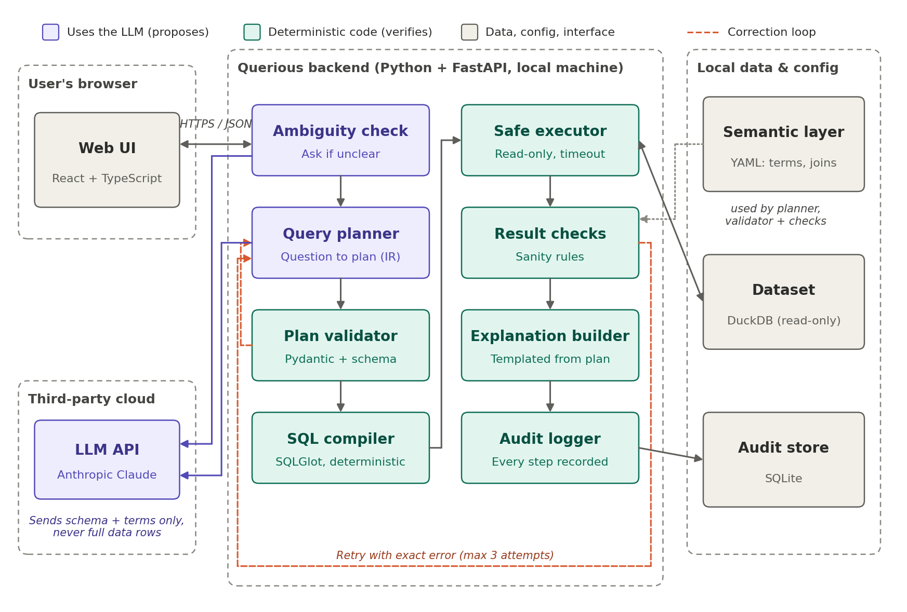
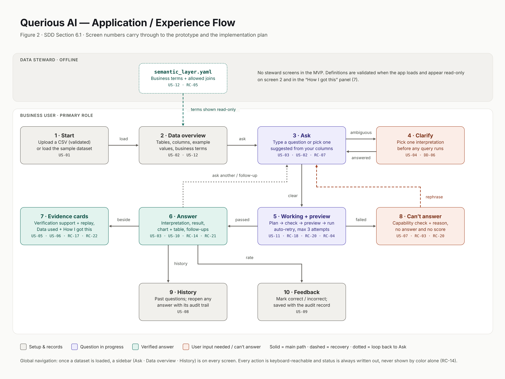

# Querious AI: proposed GitHub Issue backlog

> **Status: reviewed by the owner, with decisions applied (Section 4). The GitHub backlog was created from this file; `docs/backlog-map.md` lists the final Issue numbers.**
> Generated by Claude Code (AiDev) from Implementation Plan v1.0, November 2026. Blockers below use TMP IDs.
> Every Issue would start as Status = Backlog and Human Review = Pending, with the `ai-generated` label (POLICY Section 6).

Contents: [1. Summary table](#1-summary-table) · [2. Issue bodies](#2-full-issue-bodies) · [3. Coverage check](#3-coverage-check) · [4. Owner review decisions](#4-owner-review-decisions)

# 1. Summary table

39 rows: 38 plan items (7 updates, 31 new) plus 1 closure. The Status and Human Review values are the same for every row, so they are not repeated.

| TMP ID | Action | Title | Phase | Sequence | Priorities | Area | Executor | SDD refs | Blocked by |
|---|---|---|---|---|---|---|---|---|---|
| TMP-01 | UPDATE #3 | Scaffold FastAPI backend, React frontend, pytest and CI | P1. Foundation and Data | 1 | P0 must have | Devops | AI Dev | RC-08, RC-15, DD-07 | None |
| TMP-02 | CREATE | Implement LLM provider interface with server-side key handling | P1. Foundation and Data | 2 | P0 must have | Pipeline | AI Dev | RC-08, RC-12, RC-16, DD-01 | TMP-01 |
| TMP-03 | UPDATE #4 | Load a CSV or the sample dataset into read-only DuckDB | P1. Foundation and Data | 3 | P0 must have | Data (Csv + DuckDB) | AI Dev | US-01, RC-01, ASSUMPTION-01 | TMP-01 |
| TMP-04 | CREATE | Profile the schema and compute a dataset fingerprint | P1. Foundation and Data | 4 | P0 must have | Data (Csv + DuckDB) | AI Dev | US-02, RC-07, RC-09, OQ-05 | TMP-03 |
| TMP-05 | CREATE | Load and validate semantic_layer.yaml per dataset | P1. Foundation and Data | 5 | P0 must have | Semantic layer | AI Dev | US-12, RC-05, DD-03 | TMP-04 |
| TMP-06 | CREATE | Create the SQLite audit store with append-only events | P1. Foundation and Data | 6 | P0 must have | Pipeline | AI Dev | RC-09, RC-22, DD-10 | TMP-01 |
| TMP-07 | CREATE | Build the Start and Data overview screens | P1. Foundation and Data | 7 | P0 must have | Frontend | AI Dev | US-01, US-02, US-12, RC-13, RC-14 | TMP-03, TMP-05 |
| TMP-08 | UPDATE #8 (reopen) | Define the query-plan IR schema in Pydantic | P2. Question pipeline | 8 | P0 must have | Pipeline | AI Dev | RC-02, DD-02, OQ-02 | TMP-01 |
| TMP-09 | CREATE | Implement the LLM query planner | P2. Question pipeline | 9 | P0 must have | Pipeline | AI Dev | US-03, RC-02, RC-06, RC-07, US-12 | TMP-02, TMP-05, TMP-08 |
| TMP-10 | CREATE | Implement the plan validator and capability gate | P2. Question pipeline | 10 | P0 must have | Pipeline | AI Dev | RC-02, RC-05, RC-20, US-07, US-12 | TMP-05, TMP-08 |
| TMP-11 | UPDATE #9 | Compile validated plans to one read-only SELECT with SQLGlot | P2. Question pipeline | 11 | P0 must have | Pipeline | AI Dev | RC-01, RC-02, RC-06 | TMP-08, TMP-10 |
| TMP-12 | CREATE | Implement the safe executor with timeout and row limit | P2. Question pipeline | 12 | P0 must have | Pipeline | AI Dev | RC-01, RC-10 | TMP-03, TMP-11 |
| TMP-13 | CREATE | Build the templated plain-English summary | P2. Question pipeline | 13 | P0 must have | Pipeline | AI Dev | RC-03, RC-13, DD-04 | TMP-12 |
| TMP-14 | CREATE | Expose the question API with stage progress and audit events | P2. Question pipeline | 14 | P0 must have | Backend API | AI Dev | RC-09, RC-11, US-03, RC-03, RC-06 | TMP-06, TMP-09, TMP-10, TMP-11, TMP-12, TMP-13 |
| TMP-15a | CREATE | Build the Ask and Working screens | P2. Question pipeline | 15 | P0 must have | Frontend | AI Dev | US-03, RC-11, RC-13, RC-14 | TMP-07, TMP-14 |
| TMP-15b | CREATE | Build the Answer screen with chart and table | P2. Question pipeline | 15.5 | P0 must have | Frontend | AI Dev | US-03, RC-13, RC-14 | TMP-15a |
| TMP-16 | CREATE | Implement the ambiguity check with schema-valid alternatives | P3. Clarify and Correctness | 16 | P0 must have | Pipeline | AI Dev | US-04, RC-20, DD-06, RISK-01 | TMP-05, TMP-09, TMP-14 |
| TMP-17 | CREATE | Build the Clarify screen | P3. Clarify and Correctness | 17 | P0 must have | Frontend | AI Dev | US-04, RC-14 | TMP-15a, TMP-16 |
| TMP-18 | CREATE | Implement base result sanity checks | P3. Clarify and Correctness | 18 | P0 must have | Pipeline | Pair | RC-03, RISK-02 | TMP-12 |
| TMP-19 | UPDATE #10 | Implement bounded self-correction with exact error feedback | P3. Clarify and Correctness | 19 | P0 must have | Pipeline | AI Dev | US-06, RC-04, DD-05, RC-03, RC-22 | TMP-10, TMP-14, TMP-18 |
| TMP-20 | CREATE | Implement early rejection, honest failure and LLM service errors | P3. Clarify and Correctness | 20 | P0 must have | Pipeline | AI Dev | US-07, RC-03, RC-12, RC-20 | TMP-10, TMP-19 |
| TMP-21 | CREATE | Build the Honest failure and service-unavailable screens | P3. Clarify and Correctness | 21 | P0 must have | Frontend | AI Dev | US-07, RC-12, RC-13 | TMP-15a, TMP-20 |
| TMP-22 | CREATE | Implement the deterministic risk classifier and check registry | P4. Trust and Verification | 22 | P0 must have | Pipeline | AI Dev | US-11, RC-18, DD-09 | TMP-10, TMP-18 |
| TMP-23a | CREATE | Implement Medium-risk checks | P4. Trust and Verification | 23 | P0 must have | Pipeline | Pair | US-11, RC-18 | TMP-22 |
| TMP-23b | CREATE | Implement High-risk join checks with helper SELECTs | P4. Trust and Verification | 23.5 | P0 must have | Pipeline | Pair | US-11, RC-18, RC-23 | TMP-23a |
| TMP-24 | CREATE | Implement the deterministic trust policy with fixtures | P4. Trust and Verification | 24 | P0 must have | Pipeline | AI Dev | US-05, RC-17, DD-08 | TMP-19, TMP-23b |
| TMP-25 | CREATE | Implement the provenance builder | P4. Trust and Verification | 25 | P0 must have | Pipeline | AI Dev | US-05, RC-19 | TMP-12, TMP-23b |
| TMP-26 | CREATE | Show the capability and risk preview before execution | P4. Trust and Verification | 26 | P0 must have | Frontend | AI Dev | US-07, US-11, RC-20 | TMP-15a, TMP-22 |
| TMP-27 | UPDATE #6 | Build the Verification support and Data used cards | P4. Trust and Verification | 27 | P0 must have | Frontend | AI Dev | US-05, RC-13, RC-17, RC-19, US-11, RC-18 | TMP-24, TMP-25 |
| TMP-28 | CREATE | Complete the RC-09 audit record | P5. Audit and History | 28 | P0 must have | Pipeline | AI Dev | RC-09 | TMP-06, TMP-24, TMP-25 |
| TMP-29 | CREATE | Build the correction replay from audit events | P5. Audit and History | 29 | P0 must have | Backend API | AI Dev | US-06, RC-22 | TMP-27, TMP-28 |
| TMP-30 | CREATE | Implement question history with reopen | P5. Audit and History | 30 | P0 must have | Backend API | AI Dev | US-08, RC-09, RC-22 | TMP-15b, TMP-27, TMP-28 |
| TMP-31 | CREATE | Implement answer feedback | P5. Audit and History | 31 | P0 must have | Backend API | AI Dev | US-09, RC-09 | TMP-15b, TMP-28 |
| TMP-32 | CREATE | Generate up to three schema-validated follow-up questions | P5. Audit and History | 32 | P0 must have | Pipeline | AI Dev | US-10, RC-21 | TMP-10, TMP-15b |
| TMP-33 | CREATE | Build the frozen sample dataset and gold question set | P6. Evaluation and Hardening | 33 | P0 must have | Evaluation | Pair | US-13, OQ-03 | TMP-08 |
| TMP-34 | UPDATE #7 | Implement the one-command evaluation harness and report | P6. Evaluation and Hardening | 34 | P0 must have | Evaluation | AI Dev | US-13, RC-17, RC-18, RC-19, RC-20, RC-21, RC-22, RC-11, RISK-03 | TMP-33, TMP-17, TMP-21, TMP-26, TMP-29, TMP-30, TMP-31, TMP-32 |
| TMP-35 | CREATE | Run the accessibility and SDD acceptance pass | P6. Evaluation and Hardening | 35 | P0 must have | Evaluation | AI Dev | RC-14, RC-15, US-01, US-02, US-03, US-04, US-05, US-06, US-07, US-08, US-09, US-10, US-11, US-12, US-13 | TMP-17, TMP-21, TMP-26, TMP-29, TMP-30, TMP-31, TMP-32 |
| TMP-36 | CREATE | Optional: build the isolated baseline comparison runner | P6. Evaluation and Hardening | 36 | P2 nice to have | Evaluation | AI Dev | US-14, RC-23, DD-11, OQ-04 | TMP-34 |
| none | CLOSE #5 | Validate and compile query plans with bounded self-correction (close as superseded) | n/a | n/a | n/a | n/a | n/a | n/a | n/a |

Notes:

- **Area for TMP-29, TMP-30 and TMP-31:** these are full stack, and Area allows one value. I used Backend API because the rules that matter (read from audit, no rerun) are server-side.
- **TMP-34 and TMP-35 blockers:** the plan says "Phases 2-5" and "Phases 1-5". TMP-17, 21, 26, 29, 30, 31 and 32 are the final items of those phases, and their blockers reach every other item through to TMP-32. The script that generated this file checked that.
- **Project fields:** the built-in Priority field stays unused. The real field name is `Priorities ` with a trailing space.
- **Blockers:** the table follows the updated plan Section 5.1 exactly (also checked by script).
- **Sequence:** TMP-15b is 15.5 and TMP-23b is 23.5, as the owner decided.
- **Executor = Pair:** TMP-18, TMP-23a, TMP-23b and TMP-33, the Issues that OD-3 and OD-5 directly block.

## 1.1 Lab 2 Issues: current values and proposed values

I confirmed each match against the Issue's title and content. `-` means the field is unset today.

| Issue | Plan item | Title change | Phase | Sequence | Priorities | Executor | Status | Human Review |
|---|---|---|---|---|---|---|---|---|
| #3 | TMP-01 | "...with CI checks" to plan title | P1 (no change) | 1 (no change) | P0 (no change) | AI Dev (no change) | Staging Candidate to Backlog | - to Pending |
| #4 | TMP-03 | Narrowed to loading; profiling moves to TMP-04 | P2 to **P1** | 2 to **3** | P0 (no change) | AI Dev (no change) | Agent review to Backlog | - to Pending |
| #6 | TMP-27 | "Show..." to plan title | P3 to **P4** | 4 to **27** | P1 to **P0** | AI Dev (no change) | In progress to Backlog | - to Pending |
| #7 | TMP-34 | "Run..." to plan title | P4 to **P6** | 5 to **34** | P1 to **P0** | Human to **AI Dev** | Backlog (no change) | - to Pending |
| #8 | TMP-08 | "Define the Pydantic..." to plan title; **reopen** | - to P2 | - to 8 | - to P0 | - to AI Dev | Done in Dev to Backlog | - to Pending |
| #9 | TMP-11 | "...read only SQL and SQLGlot" to plan title | - to P2 | - to 11 | - to P0 | - to AI Dev | Backlog (no change) | - to Pending |
| #10 | TMP-19 | "Retry failed plans..." to plan title | - to P3 | - to 19 | - to P0 | - to AI Dev | Backlog (no change) | - to Pending |
| #5 | none | Close as superseded | n/a | n/a | n/a | n/a | In progress to closed | n/a |

**Evidence that the statuses are stale:** no remote branch holds any backend, frontend, eval or `.github` file. `staging` holds only a README, even though #3 is marked Staging Candidate. #8 was closed by hand with no linked commit or PR, about a minute after it was created.

Decision on #4: **narrow it to TMP-03 and create TMP-04 separately.** The plan keeps them as separate Issues, and loading and profiling are separately testable.

## 1.2 Decision for #5: close as superseded

The owner chose to close #5 rather than keep it as a parent:

- It has no TMP item, so keeping it would add a card with no Sequence.
- Its sub-issues span two phases (TMP-08 and TMP-11 in P2, TMP-19 in P3), and the three of them do not cover its own goal. "Invalid plans are rejected" needs the validator (TMP-10), which is not a sub-issue.
- Its "a PR into dev is merged" line conflicts with one Issue per PR, and it could not close until Phase 3.
- Blocked-by links and the Sequence field already give the order a parent would show.

Steps: detach #8, #9 and #10 from #5, then close #5 as "not planned" with this comment:

> Superseded by #8, #9 and #10 per Implementation Plan v1.0

## 1.3 Where each Lab 2 acceptance criterion goes

No existing criterion is dropped.

| From | Existing criterion | Goes to |
|---|---|---|
| #3 | `/health`, Vite app, CI workflow | TMP-01, kept |
| #4 | CSV up to 50 MB with header loads read-only | TMP-03, kept |
| #4 | No-header file rejected with a clear message | TMP-03, kept |
| #4 | `GET /datasets/{id}/schema` returns names, types, row count | TMP-04, kept, but the `{id}` path is dropped because only one dataset is active |
| #4 | Only schema metadata goes to the LLM | TMP-04 (serializer) and TMP-09 (payload test) |
| #5 | Plans parsed into Pydantic; invalid plans rejected before SQL | TMP-08 and TMP-10 |
| #5 | Valid plans compile to a single read-only SELECT | TMP-11, kept |
| #5 | Failed plan sent back with the error, 3 attempts | TMP-19, kept |
| #5 | Every attempt and error saved to the audit log | TMP-19, kept |
| #6 | Both cards and the "How I got this" expander | TMP-27, kept and extended |
| #7 | Command runs every question | TMP-34, kept; file path left to the Issue |
| #7 | Accuracy, attempts used, honest-failure rate | TMP-34, kept and extended to the full US-13 list |
| #7 | Saved with date and model version | TMP-34, kept |
| #7 | "First baseline report is committed" | TMP-34, reworded to "first report" so it is not confused with the US-14 baseline |

# 2. Full Issue bodies

Each body sits between `issue-body` comment markers so it can be extracted exactly. On GitHub, the Dependencies section uses real Issue numbers.

# TMP-01 · Scaffold FastAPI backend, React frontend, pytest and CI

**Action: UPDATE #3**

<!-- issue-body:start TMP-01 -->
## Goal
Create the project skeleton and the CI gate, so later Issues have a place to live and every pull request into dev is tested.

## Context
Phase: P1 - Foundation and Data | Plan item: TMP-01 | SDD: RC-08, RC-15, DD-07 | Where it sits: Repository foundation, before any pipeline stage

## Acceptance criteria
- [ ] `backend/` runs a FastAPI app on Python 3.12 with `GET /health` returning `{"status": "ok"}`
- [ ] `frontend/` is a Vite + React + TypeScript app that shows "Querious AI"
- [ ] A GitHub Actions workflow runs backend (pytest) and frontend tests on every pull request into `dev`
- [ ] The backend package layout matches ARCHITECTURE.md Section 11: `backend/app/{api,pipeline,llm,audit,semantic}/` and `backend/tests/`
- [ ] A `.gitignore` exists and covers `.env`, `data/` and build output (the repository has none today)
- [ ] The workflow uses no secrets, needs no LLM access and declares read-only token permissions
- [ ] The README documents how to run both apps locally and names the supported browsers (Chrome, Firefox, Edge desktop)
- [ ] A dependency and import scan runs in CI and fails on a hosted-database driver or account library (H12), a model SDK imported outside `app/llm/` (H13), or any import of `eval/` from `backend/app` (H14)

## Design references
SDD Section 5.1 technology table; SDD Figure 1 overall structure.

## Dependencies
Blocked by: None

## Constraints and non-goals
H12, H13, H14; AR-4, AR-9, AR-11. CLAUDE.md Section 5: stop and ask if the workflow needs a secret or a permission change. Non-goals: no product endpoints, no LLM code, no DuckDB features, no Docker or hosting, no mobile layout.

## Verification
pytest test for `/health`; a frontend smoke test; a test that the scan catches a planted violation; CI passes on the pull request itself.

## Size
Small

---
_Generated by Claude Code (AiDev) from Implementation Plan v1.0. Human Review: Pending._
<!-- issue-body:end TMP-01 -->

# TMP-02 · Implement LLM provider interface with server-side key handling

**Action: CREATE**

<!-- issue-body:start TMP-02 -->
## Goal
Give the backend one module for all model calls, with the API key held only on the server and a mock provider, so the model can change without touching pipeline logic and tests never need the network.

## Context
Phase: P1 - Foundation and Data | Plan item: TMP-02 | SDD: RC-08, RC-12, RC-16, DD-01 | Where it sits: Provider boundary between the ambiguity check / planner and the third-party LLM API

## Acceptance criteria
- [ ] `backend/app/llm/provider.py` defines `complete_json(prompt, schema) -> dict` as in ARCHITECTURE.md Section 5
- [ ] A Claude implementation reads the API key from a server-side environment variable and the model name from configuration; no model name is hard-coded (OD-1)
- [ ] Calls use the lowest-randomness settings available (RC-06)
- [ ] A mock provider returns scripted responses and records every payload it receives, for use by later tests
- [ ] Unavailable, rate-limited and timed-out calls all raise one typed provider error instead of hanging (RC-12)
- [ ] A missing key produces a clear error; a test confirms the key value never appears in logs or error text
- [ ] The TMP-01 scan confirms that no module outside `app/llm/` imports a model SDK (H13)
- [ ] `app/llm/` imports nothing from `app/pipeline/`

## Design references
SDD Figure 1, provider boundary (purple components to LLM API).

## Dependencies
Blocked by: TMP-01

## Constraints and non-goals
H1, H4, H13; AR-3, AR-4, AR-10, AR-11. Shared contract: the owner approves this pull request, and AiDev does not self-merge it. CLAUDE.md Section 5: adding the model SDK is a dependency that makes network calls, so ask the owner on this Issue before adding it. Non-goals: no prompts, no planner, no retry loop, no second provider, no model selection.

## Verification
Unit tests with the mock provider and a faked transport; no test touches the network or the real LLM.

## Size
Small

---
_Generated by Claude Code (AiDev) from Implementation Plan v1.0. Human Review: Pending._
<!-- issue-body:end TMP-02 -->

# TMP-03 · Load a CSV or the sample dataset into read-only DuckDB

**Action: UPDATE #4**

<!-- issue-body:start TMP-03 -->
## Goal
A business user can upload a CSV or pick the sample dataset, and it becomes the one active dataset in a local DuckDB file that questions can only read.

## Context
Phase: P1 - Foundation and Data | Plan item: TMP-03 | SDD: US-01, RC-01, ASSUMPTION-01 | Where it sits: Data layer, behind screen 1 (Start)

## Acceptance criteria
- [ ] A CSV with a header row and a size up to 50 MB loads into a local DuckDB file, and its table and columns are available within 10 seconds (US-01)
- [ ] A non-CSV, header-less or over-50 MB file is rejected with a clear message; an invalid file is never accepted and a valid file never fails silently
- [ ] An API action loads the bundled small synthetic sample: two tables (customers and orders) with one declared join. It is the only multi-table dataset; TMP-33 freezes it later
- [ ] The loader writes the DuckDB file once, at load time; after that, access is read-only. The read-only connection function starts in `backend/app/pipeline/executor.py`, and a test confirms that any write through it fails (RC-01)
- [ ] The last loaded dataset is still available after a restart (owner decision, ARCHITECTURE.md Section 8)
- [ ] Change dataset replaces the active dataset; only one is active at a time
- [ ] English column names are a documented assumption (ASSUMPTION-01) and are not enforced

## Design references
Screen 1 Start (upload card, sample button, file-error state); prototype flow A (SDD Table 6.2); SDD Figure 1 data layer.

## Dependencies
Blocked by: TMP-01

## Constraints and non-goals
H3, H12; AR-2, AR-9; POLICY D-3, D-5, D-6. Non-goals: no schema profile, fingerprint or schema endpoint (TMP-04), no screens (TMP-07), no question execution (TMP-12), no several datasets at once, no hosted database.

## Verification
API tests with small synthetic CSV fixtures (valid, non-CSV, header-less); an over-limit file generated during the test and not committed; a load-time assertion; a restart test; a write-rejection test.

## Size
Medium

---
_Generated by Claude Code (AiDev) from Implementation Plan v1.0. Human Review: Pending._
<!-- issue-body:end TMP-03 -->

# TMP-04 · Profile the schema and compute a dataset fingerprint

**Action: CREATE**

<!-- issue-body:start TMP-04 -->
## Goal
The system knows the active dataset's tables, columns, types and row count, and has a stable fingerprint for it, so the overview, the planner and the audit record all use the same facts.

## Context
Phase: P1 - Foundation and Data | Plan item: TMP-04 | SDD: US-02, RC-07, RC-09, OQ-05 | Where it sits: Data layer, feeding screen 2 (Data overview), the planner and the audit record

## Acceptance criteria
- [ ] The loader computes the schema profile and fingerprint during load and stores them, so no module but the executor opens the dataset afterward
- [ ] An API endpoint returns the active dataset's table and column names, inferred types and row count from the stored profile (carried over from #4)
- [ ] Example values (at most five per text column) are available for local display on the Data overview only
- [ ] A separate LLM-facing schema serializer outputs names and types only; a test confirms it contains no row or example values (H4, OD-4), and no setting can turn example values on
- [ ] The fingerprint is deterministic: the same file gives the same value and a one-byte change gives a different one
- [ ] The profile and fingerprint are still available after a restart

## Design references
Screen 2 Data overview; SDD Figure 1 data layer.

## Dependencies
Blocked by: TMP-03

## Constraints and non-goals
H4, H12; AR-3; POLICY D-1. The MVP has no code path that sends example values to the LLM (OD-4). Non-goals: no prompts, no UI, no semantic-layer work.

## Verification
Unit and API tests with synthetic CSVs: type inference, row count, fingerprint stability, and the no-values serializer test.

## Size
Small

---
_Generated by Claude Code (AiDev) from Implementation Plan v1.0. Human Review: Pending._
<!-- issue-body:end TMP-04 -->

# TMP-05 · Load and validate semantic_layer.yaml per dataset

**Action: CREATE**

<!-- issue-body:start TMP-05 -->
## Goal
A data steward can define business terms, metrics and allowed joins for a dataset in a YAML file, and bad definitions are refused with an error that names the problem.

## Context
Phase: P1 - Foundation and Data | Plan item: TMP-05 | SDD: US-12, RC-05, DD-03 | Where it sits: Semantic layer, read by the planner, validator, result checks and Data overview

## Acceptance criteria
- [ ] `backend/app/semantic/schema.py` defines the format: one section per dataset, holding terms, metrics and declared joins, each with a plain-English description
- [ ] The active dataset's section is validated each time that dataset becomes active
- [ ] An upload with no section has no terms and no joins, and this is not an error
- [ ] The sample dataset's section holds its terms and its one declared join
- [ ] A definition that refers to a missing column is rejected at load time with an error naming the term and the column (US-12)
- [ ] A join that refers to a missing table or column is rejected at load time
- [ ] The SDD example term (active customer = customer with an order in the last 90 days) loads from a fixture; a definition that cannot be expressed as a declared join plus filter with a distinct count is rejected at load
- [ ] A read-only API returns every term with its description; no endpoint can edit terms
- [ ] A semantic-layer version value is available for the audit record (RC-09)

## Design references
Screen 2 terms list; SDD Figure 1 semantic layer; Figure 2 data steward lane.

## Dependencies
Blocked by: TMP-04

## Constraints and non-goals
H8; AR-6; POLICY P-5, D-6. Shared contract: the owner approves this pull request, and AiDev does not self-merge it. Non-goals: no graphical editor (SDD 2.3), no steward screen, no applying terms to plans (TMP-09, TMP-10).

## Verification
Unit tests with valid and invalid YAML fixtures that assert the exact error content; tests for an upload with no section and for revalidation when the active dataset changes.

## Size
Medium

---
_Generated by Claude Code (AiDev) from Implementation Plan v1.0. Human Review: Pending._
<!-- issue-body:end TMP-05 -->

# TMP-06 · Create the SQLite audit store with append-only events

**Action: CREATE**

<!-- issue-body:start TMP-06 -->
## Goal
Every later pipeline step has one append-only place to record what happened, so history and replay are built from evidence and not retrofitted.

## Context
Phase: P1 - Foundation and Data | Plan item: TMP-06 | SDD: RC-09, RC-22, DD-10 | Where it sits: Audit store, written by every pipeline step (SDD Figure 1)

## Acceptance criteria
- [ ] `backend/app/audit/events.py` defines a versioned event model, stored in a local SQLite file in the data folder
- [ ] The store exposes append and read only; a test confirms no update or delete path exists
- [ ] Events are keyed by question ID and attempt number, with timestamps, and read back in order
- [ ] The base event types cover the question, plan attempt, error and check result, and can be extended later without breaking old events
- [ ] Records survive a restart
- [ ] `audit` is the only module that opens SQLite

## Design references
SDD Figure 1 audit logger and audit store.

## Dependencies
Blocked by: TMP-01

## Constraints and non-goals
H10, H12; AR-7, AR-9; POLICY D-4. Shared contract: the owner approves this pull request, and AiDev does not self-merge it. Non-goals: not every RC-09 field yet (TMP-28), no history or replay views, no clear-history action.

## Verification
Unit tests with a temporary SQLite file: append, ordered read, restart persistence and the no-mutation test.

## Size
Small

---
_Generated by Claude Code (AiDev) from Implementation Plan v1.0. Human Review: Pending._
<!-- issue-body:end TMP-06 -->

# TMP-07 · Build the Start and Data overview screens

**Action: CREATE**

<!-- issue-body:start TMP-07 -->
## Goal
A business user can load data and see what is in it: tables, columns, types, example values and business terms, inside the navy sidebar layout.

## Context
Phase: P1 - Foundation and Data | Plan item: TMP-07 | SDD: US-01, US-02, US-12, RC-13, RC-14 | Where it sits: Screens 1 and 2

## Acceptance criteria
- [ ] Screen 1: upload card with type, size and header checks, a sample-dataset button and a clear file-error state
- [ ] A valid dataset's table and columns are displayed within 10 seconds (US-01)
- [ ] Screen 2 lists every table and column with its type and example values, and every semantic-layer term with its plain-English description (US-02)
- [ ] Terms are read-only
- [ ] Once a dataset is loaded, a navy sidebar shows the current dataset and links to Ask, Data overview, History and Change dataset; links to screens not yet built are disabled
- [ ] Keyboard navigation works, controls have screen-reader labels, and status is not shown by color alone (RC-14)

## Design references
Screens 1-2; prototype flow A (SDD Table 6.2); SDD Figure 2; [Prototype](https://claude.ai/artifact/Afcj1f7hvk7mhgHfFhNtQJ) (page "6.2 Prototype (refined)").

## Dependencies
Blocked by: TMP-03, TMP-05

## Constraints and non-goals
H12; POLICY E-2, D-6. The frontend talks only to the backend API. Non-goals: no Ask screen (TMP-15), no term editing, no mobile layout.

## Verification
Component tests against a mocked API; UI tests for the valid and invalid file states and the term list.

## Size
Medium

---
_Generated by Claude Code (AiDev) from Implementation Plan v1.0. Human Review: Pending._
<!-- issue-body:end TMP-07 -->

# TMP-08 · Define the query-plan IR schema in Pydantic

**Action: UPDATE #8 (reopen)**

<!-- issue-body:start TMP-08 -->
## Goal
Define the one JSON query-plan shape that the planner must produce and that the validator, compiler, risk classifier and trust policy all share.

## Context
Phase: P2 - Question pipeline | Plan item: TMP-08 | SDD: RC-02, DD-02, OQ-02 | Where it sits: Shared contract between the planner and every deterministic step

## Acceptance criteria
- [ ] `backend/app/pipeline/ir.py` defines a Pydantic model covering exactly filters, aggregations, grouping, sorting, top-N, time bucketing and declared joins (OQ-02), plus column selection (treated as implied by OQ-02 and RC-18, not an extension) and references to semantic-layer terms
- [ ] Unknown fields are rejected, and no field can carry free SQL or a free expression
- [ ] Malformed input produces precise errors that name the field and the problem (these feed TMP-19)
- [ ] A plan round-trips through JSON without changes
- [ ] Relative dates (for example, "last 90 days") can be expressed in a plan, and the model has a place to record the absolute dates they resolve to
- [ ] The model exports a JSON Schema for the provider's `complete_json` call
- [ ] The schema carries a version value

## Design references
SDD Figure 1 (planner to validator); SDD 2.3 IR limits.

## Dependencies
Blocked by: TMP-01

## Constraints and non-goals
H2; AR-1. Shared contract: the owner approves this pull request, AiDev does not self-merge it, and later changes need an ADR. Non-goals: no window functions, nested subqueries or free SQL (OD-2); no checks against the dataset (TMP-10). This Issue was closed in Lab 2 with no code behind it, so it reopens here.

## Verification
Unit tests: one valid fixture per operation; rejection fixtures for unknown fields, unsupported operations and SQL-bearing strings.

## Size
Small

---
_Generated by Claude Code (AiDev) from Implementation Plan v1.0. Human Review: Pending._
<!-- issue-body:end TMP-08 -->

# TMP-09 · Implement the LLM query planner

**Action: CREATE**

<!-- issue-body:start TMP-09 -->
## Goal
Turn a plain-English question into a draft query plan, sending the model only schema metadata and business definitions.

## Context
Phase: P2 - Question pipeline | Plan item: TMP-09 | SDD: US-03, RC-02, RC-06, RC-07, US-12 | Where it sits: Query planner (LLM-assisted), after the ambiguity check and before the validator

## Acceptance criteria
- [ ] The prompt contains only table and column names and types, semantic-layer definitions, the question and, on a retry, the error message with literal values removed
- [ ] A test inspects the payload sent to the mock provider and confirms it holds no row values (required H4 test)
- [ ] The planner calls the model only through the provider interface, using the IR's JSON Schema
- [ ] The response is parsed into the IR; output that is not a valid IR raises a precise error and is never executed (RC-02)
- [ ] Steward definitions for terms in the question are included in the prompt (US-12)
- [ ] The result includes the model identifier and prompt version for the audit record

## Design references
SDD Figure 1 query planner; screen 5 Working, planning stage.

## Dependencies
Blocked by: TMP-02, TMP-05, TMP-08

## Constraints and non-goals
H1, H2, H4, H13; AR-1, AR-3, AR-10, AR-11. Non-goals: no execution, no retry loop (TMP-19), no ambiguity check (TMP-16), no LLM-written summaries, no example values.

## Verification
Unit tests with the mock provider and frozen fixtures for valid, malformed and non-IR responses; never the real LLM.

## Size
Medium

---
_Generated by Claude Code (AiDev) from Implementation Plan v1.0. Human Review: Pending._
<!-- issue-body:end TMP-09 -->

# TMP-10 · Implement the plan validator and capability gate

**Action: CREATE**

<!-- issue-body:start TMP-10 -->
## Goal
Only plans that fit the real schema, the steward's definitions and the supported operations can move on, and every refusal says exactly why.

## Context
Phase: P2 - Question pipeline | Plan item: TMP-10 | SDD: RC-02, RC-05, RC-20, US-07, US-12 | Where it sits: Plan validator, between the planner and the compiler

## Acceptance criteria
- [ ] Unknown tables, columns and terms are rejected with an error naming the item
- [ ] A join not declared in the semantic layer fails validation (RC-05, H8)
- [ ] A term in a plan uses the steward's definition, not the model's (US-12)
- [ ] On a dataset with no semantic-layer section, any term or join in a plan is rejected
- [ ] The capability gate rejects unsupported operations; a newly discovered unsupported plan stops at validation (RC-20, US-07)
- [ ] Errors are structured and precise enough to send back to the planner (TMP-19)
- [ ] A pass returns a distinct validated-plan type, and only that type is accepted by the compiler
- [ ] The validator executes nothing and calls no model

## Design references
SDD Figure 1 plan validator; screen 5 checking stage; screen 8 capability line.

## Dependencies
Blocked by: TMP-05, TMP-08

## Constraints and non-goals
H2, H5, H8; AR-1, AR-6. Non-goals: no risk classification (TMP-22), no rejection at the understanding stage (TMP-20), no IR changes.

## Verification
Unit tests: one fixture per rejection type asserting the exact error; undeclared-join test; an execution spy records zero executions.

## Size
Medium

---
_Generated by Claude Code (AiDev) from Implementation Plan v1.0. Human Review: Pending._
<!-- issue-body:end TMP-10 -->

# TMP-11 · Compile validated plans to one read-only SELECT with SQLGlot

**Action: UPDATE #9**

<!-- issue-body:start TMP-11 -->
## Goal
Turn a validated plan into exactly one read-only SELECT, the same way every time, using code and not the model.

## Context
Phase: P2 - Question pipeline | Plan item: TMP-11 | SDD: RC-01, RC-02, RC-06 | Where it sits: SQL compiler, between the validator and the safe executor

## Acceptance criteria
- [ ] The compiler accepts only the validated-plan type; invalid plans never reach SQL
- [ ] Each supported IR operation compiles to a single SELECT with SQLGlot
- [ ] The same validated plan compiled twice gives byte-identical SQL, including across separate processes (RC-06)
- [ ] Compiled SQL is parsed back and rejected before execution if it is not a single read-only SELECT (required H3 test)
- [ ] A semantic-layer term compiles as a declared join plus filter with a distinct count, with no subquery
- [ ] Relative dates are resolved to absolute dates before compiling, and the dates used are recorded
- [ ] Identifiers are quoted and values are escaped; a filter value such as `'; DROP TABLE x; --` stays inert data

## Design references
SDD Figure 1 SQL compiler.

## Dependencies
Blocked by: TMP-08, TMP-10

## Constraints and non-goals
H2, H3; AR-1, AR-2, AR-10. Non-goals: no execution (TMP-12), no window functions or subqueries, no acceptance of SQL text from any model.

## Verification
Golden-SQL tests per IR operation, including a term and a relative date; a determinism test with a fixed clock; rejection tests for DML, DDL and multi-statement input; an escaping test.

## Size
Medium

---
_Generated by Claude Code (AiDev) from Implementation Plan v1.0. Human Review: Pending._
<!-- issue-body:end TMP-11 -->

# TMP-12 · Implement the safe executor with timeout and row limit

**Action: CREATE**

<!-- issue-body:start TMP-12 -->
## Goal
All SQL runs through one guarded place: read-only, stopped at 15 seconds, and never returning more than 5,000 rows.

## Context
Phase: P2 - Question pipeline | Plan item: TMP-12 | SDD: RC-01, RC-10 | Where it sits: Safe executor, the only code that runs SQL

## Acceptance criteria
- [ ] The executor opens DuckDB read-only, and a test confirms a write attempt fails
- [ ] A 16-second query is stopped by the 15-second timeout with a typed error
- [ ] At most 5,000 result rows are returned; the returned count and a truncation flag are recorded
- [ ] A single safety gate rejects anything but one SELECT before execution; multi-statement input never runs
- [ ] The same gate and limits are callable for internal helper SELECTs (RC-23), with no way to reach them from the API
- [ ] Database errors are returned as typed errors for the correction loop
- [ ] A reusable execution spy is available for later zero-execution tests

## Design references
SDD Figure 1 safe executor and dataset.

## Dependencies
Blocked by: TMP-03, TMP-11

## Constraints and non-goals
H3 (helper SELECTs allowed only through the same gate and limits); AR-2, AR-9. Extends the read-only connection function started in TMP-03. Non-goals: no result checks (TMP-18), no retries (TMP-19), no helper queries themselves (TMP-23, TMP-25).

## Verification
Unit tests with a synthetic dataset and a deliberately slow query: timeout, row limit, truncation flag, write rejection and multi-statement rejection.

## Size
Small

---
_Generated by Claude Code (AiDev) from Implementation Plan v1.0. Human Review: Pending._
<!-- issue-body:end TMP-12 -->

# TMP-13 · Build the templated plain-English summary

**Action: CREATE**

<!-- issue-body:start TMP-13 -->
## Goal
Summaries and the "How I read your question" text come from the validated plan and the actual results, so the explanation cannot differ from what ran.

## Context
Phase: P2 - Question pipeline | Plan item: TMP-13 | SDD: RC-03, RC-13, DD-04 | Where it sits: Explanation builder, after execution; content for screen 6

## Acceptance criteria
- [ ] The headline and summary are generated by templates from the validated plan and executed results
- [ ] A test confirms every number in a summary appears in the result set (RC-03, H5)
- [ ] "How I read your question" and the plain-English plan are generated by templates (H9)
- [ ] A failed or empty run produces no numeric summary; an empty result shows a "no rows matched" message (required H5 test, POLICY P-8)
- [ ] Text uses plain business language, with no SQL, and never says "correct" or "guaranteed" (RC-13, POLICY E-1)
- [ ] The module imports nothing from `app/llm/`

## Design references
Screen 6 headline and summary; SDD Figure 1 explanation builder.

## Dependencies
Blocked by: TMP-12

## Constraints and non-goals
H1, H5, H9; AR-7; POLICY P-1, E-1. Non-goals: no trust reasons (TMP-24), no chart (TMP-15), no LLM-written text.

## Verification
Unit tests with plan and result fixtures for each template, plus the number-provenance and no-LLM-import tests.

## Size
Small

---
_Generated by Claude Code (AiDev) from Implementation Plan v1.0. Human Review: Pending._
<!-- issue-body:end TMP-13 -->

# TMP-14 · Expose the question API with stage progress and audit events

**Action: CREATE**

<!-- issue-body:start TMP-14 -->
## Goal
The browser can submit a question and watch its current stage while the backend runs plan, validate, compile and execute, with every step recorded.

## Context
Phase: P2 - Question pipeline | Plan item: TMP-14 | SDD: RC-09, RC-11, US-03, RC-03, RC-06 | Where it sits: API layer, between the frontend and the pipeline; drives screen 5

## Acceptance criteria
- [ ] An endpoint accepts a question; a clear, supported question returns a results table and summary backed by an executed query (US-03, RC-03)
- [ ] A stage endpoint reports understanding, planning, checking or running, and the browser polls it about every 500 ms (OD-6, AR-12)
- [ ] Every step writes audit events, including failures, with the plan, SQL, errors, model identifier and dataset fingerprint
- [ ] Every plan is stored, so results can be reproduced (RC-06)
- [ ] The browser never receives SQL before it runs
- [ ] No response contains a number without an executed result
- [ ] Result checks report under the running stage
- [ ] No step waits for user confirmation between validation and execution
- [ ] The understanding stage is a pass-through until TMP-16 and TMP-20 add behaviour, and the code marks this

## Design references
Screen 5 four stages; SDD Figure 1 full path; ARCHITECTURE.md Section 3.

## Dependencies
Blocked by: TMP-06, TMP-09, TMP-10, TMP-11, TMP-12, TMP-13

## Constraints and non-goals
H3, H5, H10; AR-2, AR-7, AR-11, AR-12. Non-goals: no retries (TMP-19), no clarification (TMP-16), no trust level (TMP-24), no SSE or WebSockets, no second dataset.

## Verification
API tests with the mock provider for the happy path, the stage sequence and the audit events written; a test that no SQL appears before execution.

## Size
Medium

---
_Generated by Claude Code (AiDev) from Implementation Plan v1.0. Human Review: Pending._
<!-- issue-body:end TMP-14 -->

# TMP-15a · Build the Ask and Working screens

**Action: CREATE**

<!-- issue-body:start TMP-15a -->
## Goal
A business user can type or pick a question and see the current stage while it works.

## Context
Phase: P2 - Question pipeline | Plan item: TMP-15a | SDD: US-03, RC-11, RC-13, RC-14 | Where it sits: Screens 3 and 5

## Acceptance criteria
- [ ] Screen 3: "Ask your data" card and the can / can't scope hint
- [ ] Screen 3 shows suggested questions built from templates over the loaded dataset's schema and terms, with no LLM call, each checked against the schema
- [ ] Screen 5: four named stages from polling about every 500 ms (OD-6)
- [ ] Screen 5 shows the "Nothing has been run on your data yet" note until execution starts
- [ ] SQL and the raw plan do not appear on these screens (RC-13)
- [ ] Keyboard navigation works, controls have screen-reader labels, and status is not shown by color alone

## Design references
Screens 3 and 5; prototype flow A (SDD Table 6.2); SDD Figure 2; [Prototype](https://claude.ai/artifact/Afcj1f7hvk7mhgHfFhNtQJ) (page "6.2 Prototype (refined)").

## Dependencies
Blocked by: TMP-07, TMP-14

## Constraints and non-goals
H1, H5; AR-12; POLICY P-1, E-2. The prototype's in-browser planner is not reused. Non-goals: no Answer screen (TMP-15b), no clarify screen (TMP-17), no preview line (TMP-26), no client-side SQL or LLM calls.

## Verification
Component tests against a mocked API; UI tests for stage polling and for suggestions on sample and upload schemas; a test that suggestions make no model call.

## Size
Medium

---
_Generated by Claude Code (AiDev) from Implementation Plan v1.0. Human Review: Pending._
<!-- issue-body:end TMP-15a -->

# TMP-15b · Build the Answer screen with chart and table

**Action: CREATE**

<!-- issue-body:start TMP-15b -->
## Goal
A business user reads the answer as a headline, an interpretation, a chart and its table.

## Context
Phase: P2 - Question pipeline | Plan item: TMP-15b | SDD: US-03, RC-13, RC-14 | Where it sits: Screen 6

## Acceptance criteria
- [ ] Screen 6 shows the headline, the summary and the result chart and table
- [ ] "How I read your question" shows the interpretation, including the user's choice when there was one, with a "Not what you meant? Rephrase" action
- [ ] A bar or line chart appears only when the result shape supports one, and every chart has its table via "View the underlying table" (RC-14)
- [ ] An empty result shows "no rows matched" and no number (POLICY P-8)
- [ ] SQL and the raw plan do not appear on this screen (RC-13)
- [ ] Keyboard navigation works, controls have screen-reader labels, and status is not shown by color alone

## Design references
Screen 6; prototype flows B and C (SDD Table 6.2); SDD Figure 2; [Prototype](https://claude.ai/artifact/Afcj1f7hvk7mhgHfFhNtQJ) (page "6.2 Prototype (refined)").

## Dependencies
Blocked by: TMP-15a

## Constraints and non-goals
H5, H9; POLICY P-1, P-8, E-1, E-2. Non-goals: no verification cards (TMP-27), no follow-ups (TMP-32), no feedback buttons (TMP-31).

## Verification
Component tests against a mocked API; UI tests for chart plus table, a non-chartable result and an empty result.

## Size
Medium

---
_Generated by Claude Code (AiDev) from Implementation Plan v1.0. Human Review: Pending._
<!-- issue-body:end TMP-15b -->

# TMP-16 · Implement the ambiguity check with schema-valid alternatives

**Action: CREATE**

<!-- issue-body:start TMP-16 -->
## Goal
The system spots a question with more than one reasonable meaning and offers two or three described choices before anything runs.

## Context
Phase: P3 - Clarify and Correctness | Plan item: TMP-16 | SDD: US-04, RC-20, DD-06, RISK-01 | Where it sits: Ambiguity check (LLM-assisted), the first pipeline step

## Acceptance criteria
- [ ] The check calls the model only through the provider interface and sends only schema metadata, terms and the question (H4)
- [ ] An ambiguous question returns two or three alternatives, each stating its measure, grouping or time-period definition (US-04)
- [ ] Every alternative is checked against available columns and steward definitions; an invalid one is never shown (RC-20)
- [ ] The user's selection is recorded in the audit log and revalidated before planning (RC-20)
- [ ] An execution spy confirms zero executions before a selection
- [ ] The question API returns the alternatives and accepts the selection

## Design references
Screen 4 Clarify; prototype flow B; SDD Figure 1 ambiguity check.

## Dependencies
Blocked by: TMP-05, TMP-09, TMP-14

## Constraints and non-goals
H1, H4, H7, H10; AR-3, AR-11; POLICY P-2. Non-goals: no screen (TMP-17), no tuning on gold answers, and the model does not judge its own answer.

## Verification
Unit tests with the mock provider for clear, ambiguous and invalid-alternative cases; a payload test; a spy test.

## Size
Medium

---
_Generated by Claude Code (AiDev) from Implementation Plan v1.0. Human Review: Pending._
<!-- issue-body:end TMP-16 -->

# TMP-17 · Build the Clarify screen

**Action: CREATE**

<!-- issue-body:start TMP-17 -->
## Goal
A business user compares described meanings and chooses one, with no default and a clean way out.

## Context
Phase: P3 - Clarify and Correctness | Plan item: TMP-17 | SDD: US-04, RC-14 | Where it sits: Screen 4, between Ask and Working

## Acceptance criteria
- [ ] Options are radio buttons that state each definition, and none is preselected
- [ ] Continue is disabled until one is chosen
- [ ] "None of these, rephrase" executes nothing and returns to Ask
- [ ] The note "No query has been run yet" is shown
- [ ] The selected interpretation is used for the plan and returned in the answer response, for TMP-15b to display
- [ ] All controls are reachable by keyboard and labeled for screen readers

## Design references
Screen 4; prototype flow B (SDD Table 6.2); SDD Figure 2; [Prototype](https://claude.ai/artifact/Afcj1f7hvk7mhgHfFhNtQJ) (page "6.2 Prototype (refined)").

## Dependencies
Blocked by: TMP-15a, TMP-16

## Constraints and non-goals
H7; POLICY P-2, E-2. Non-goals: no free-text clarification, no remembered defaults.

## Verification
UI tests for the disabled Continue, no preselection and the keyboard path; an API-level test that rephrase runs nothing.

## Size
Small

---
_Generated by Claude Code (AiDev) from Implementation Plan v1.0. Human Review: Pending._
<!-- issue-body:end TMP-17 -->

# TMP-18 · Implement base result sanity checks

**Action: CREATE**

<!-- issue-body:start TMP-18 -->
## Goal
Results that do not make sense are caught before release, with a specific reason the correction loop can use.

## Context
Phase: P3 - Clarify and Correctness | Plan item: TMP-18 | SDD: RC-03, RISK-02 | Where it sits: Result checks, after the safe executor

## Acceptance criteria
- [ ] Checks exist for an empty result, impossible percentages and unexpected row multiplication after joins
- [ ] Each check records one outcome: passed, failed, warning or unavailable
- [ ] Each failure has a specific message that contains no row values
- [ ] The starting checks and thresholds live in configuration, and the owner approves them on this Issue before merge (OD-5)
- [ ] An empty result is a non-blocking warning: it does not trigger a retry (POLICY P-8)
- [ ] Check outcomes are written to the audit log

## Design references
SDD Figure 1 result checks; SDD 2.2.

## Dependencies
Blocked by: TMP-12

## Constraints and non-goals
H5, H6, H10; AR-5. Pair: the agent proposes thresholds and the owner approves them. Non-goals: no Medium or High checks (TMP-23), no retry logic (TMP-19), no model judging results.

## Verification
Unit tests with result fixtures for each check on both sides of each threshold; a message test for no row values.

## Size
Small

---
_Generated by Claude Code (AiDev) from Implementation Plan v1.0. Human Review: Pending._
<!-- issue-body:end TMP-18 -->

# TMP-19 · Implement bounded self-correction with exact error feedback

**Action: UPDATE #10**

<!-- issue-body:start TMP-19 -->
## Goal
When a plan or result fails, the system sends the specific problem back to the planner, at most three planning attempts in total, and logs every attempt.

## Context
Phase: P3 - Clarify and Correctness | Plan item: TMP-19 | SDD: US-06, RC-04, DD-05, RC-03, RC-22 | Where it sits: Dashed correction loop in SDD Figure 1

## Acceptance criteria
- [ ] Retries are triggered only by a validation error, a database error or a failed check, never by asking the model to judge its answer
- [ ] Each retry includes the specific error
- [ ] The loop stops after 3 attempts and logs each one with its plan, error and checks (required H6 test)
- [ ] An injected first-attempt schema failure is recovered within three total planning attempts (US-06)
- [ ] Each corrected plan is revalidated (and reclassified once TMP-22 exists)
- [ ] Failed attempts never display a result as an answer
- [ ] Literal values are removed from database errors before they go in the prompt, and the full error stays in the local audit log (H4, POLICY D-1)
- [ ] An empty result does not trigger a retry (POLICY P-8)
- [ ] The current attempt number is available for "Attempt n of 3"
- [ ] After the third failure, the question moves to the honest failure state with no number

## Design references
Prototype flow C (SDD Table 6.2); screen 5 "Attempt n of 3"; SDD Figure 1 correction loop.

## Dependencies
Blocked by: TMP-10, TMP-14, TMP-18

## Constraints and non-goals
H4, H5, H6, H10; AR-3, AR-5, AR-11. Non-goals: no replay view (TMP-29), no failure screen (TMP-21), no fourth attempt, no self-assessment prompt.

## Verification
Tests with the mock provider: scripted failure then success; three failures; a call-count assertion; audit assertions; a payload test with a DuckDB error containing a cell value, plus an audit assertion that the full error was kept.

## Size
Medium

---
_Generated by Claude Code (AiDev) from Implementation Plan v1.0. Human Review: Pending._
<!-- issue-body:end TMP-19 -->

# TMP-20 · Implement early rejection, honest failure and LLM service errors

**Action: CREATE**

<!-- issue-body:start TMP-20 -->
## Goal
Requests the system cannot safely answer stop early with a reason and a usable rephrasing, and no number ever appears on a failure path.

## Context
Phase: P3 - Clarify and Correctness | Plan item: TMP-20 | SDD: US-07, RC-03, RC-12, RC-20 | Where it sits: Understanding stage and every failure exit from the pipeline

## Acceptance criteria
- [ ] Known forecasting, causal "why", data-changing and otherwise unsupported requests stop at understanding, before compilation, using deterministic rules (RC-20)
- [ ] Missing-data requests stop before compilation or execution, and an execution spy records zero executions for all early-rejected cases (US-07)
- [ ] Each rejection has a reason and a schema-valid rephrasing suggestion from templates
- [ ] After three failed attempts, the response has no answer and no score
- [ ] A failed or empty pipeline run returns no numeric answer (required H5 test)
- [ ] With the LLM unavailable or rate-limited, the API returns a clear service error, not a hang or a partial answer (RC-12)
- [ ] Every rejection and failure is written to the audit log

## Design references
Prototype flow E (SDD Table 6.2); SDD Figure 1 failure exits.

## Dependencies
Blocked by: TMP-10, TMP-19

## Constraints and non-goals
H1, H3, H5, H10; AR-1, AR-2, AR-11; POLICY P-1, P-4, D-5. Non-goals: no screens (TMP-21), no model-written reasons, no attempt to answer forecasting or causal questions.

## Verification
Fixture questions per rejection type with the execution spy; a mock provider that raises the service error; a response test for no numbers or score.

## Size
Medium

---
_Generated by Claude Code (AiDev) from Implementation Plan v1.0. Human Review: Pending._
<!-- issue-body:end TMP-20 -->

# TMP-21 · Build the Honest failure and service-unavailable screens

**Action: CREATE**

<!-- issue-body:start TMP-21 -->
## Goal
When there is no answer, the user sees why, what was tried and how to rephrase, with no number on the screen.

## Context
Phase: P3 - Clarify and Correctness | Plan item: TMP-21 | SDD: US-07, RC-12, RC-13 | Where it sits: Screen 8 and the AI-service-unavailable state

## Acceptance criteria
- [ ] Screen 8 shows the reason, "What I tried", "No numbers are shown", the capability line, the attempt list and schema-valid suggestions
- [ ] No answer and no score appear on this screen
- [ ] Rephrase returns to Ask
- [ ] The service-unavailable state shows a clear message with Try again, not a hang or a partial answer
- [ ] Status is written out and not shown by color alone; controls are keyboard-reachable

## Design references
Screen 8; prototype flow E (SDD Table 6.2); SDD Figure 2; [Prototype](https://claude.ai/artifact/Afcj1f7hvk7mhgHfFhNtQJ) (page "6.2 Prototype (refined)").

## Dependencies
Blocked by: TMP-15a, TMP-20

## Constraints and non-goals
H5; POLICY P-1, E-1, E-2. Non-goals: no step-through replay (TMP-29), no technical stack traces in the main view.

## Verification
Component and UI tests for each failure type and the Try again path, asserting no numeric answer renders.

## Size
Small

---
_Generated by Claude Code (AiDev) from Implementation Plan v1.0. Human Review: Pending._
<!-- issue-body:end TMP-21 -->

# TMP-22 · Implement the deterministic risk classifier and check registry

**Action: CREATE**

<!-- issue-body:start TMP-22 -->
## Goal
Each validated plan gets a fixed risk class that decides which checks are mandatory, so harder questions get stronger verification.

## Context
Phase: P4 - Trust and Verification | Plan item: TMP-22 | SDD: US-11, RC-18, DD-09 | Where it sits: Validator step, feeding the preview and result checks

## Acceptance criteria
- [ ] Fixed low, medium and high plan fixtures receive the exact RC-18 class, using the highest applicable class
- [ ] A question that required semantic clarification is classified High
- [ ] Each corrected plan is reclassified
- [ ] A small versioned registry lists the mandatory checks for each class and their applicability
- [ ] The class, the policy version and the applicable checks are logged
- [ ] Unsupported operations are rejected regardless of risk
- [ ] The classifier calls no model

## Design references
SDD Figure 1 (validator includes the risk classifier); SDD Section 5.2 note.

## Dependencies
Blocked by: TMP-10, TMP-18

## Constraints and non-goals
H6, H10; AR-8; contract: policy versions (ARCHITECTURE.md Section 5). Non-goals: no Medium or High check logic (TMP-23), no new IR operations, no model-assigned risk.

## Verification
Unit tests with fixed plan fixtures for every RC-18 rule and the highest-class-wins case.

## Size
Small

---
_Generated by Claude Code (AiDev) from Implementation Plan v1.0. Human Review: Pending._
<!-- issue-body:end TMP-22 -->

# TMP-23a · Implement Medium-risk checks

**Action: CREATE**

<!-- issue-body:start TMP-23a -->
## Goal
Medium-risk plans must pass aggregate, null, grain and date checks before an answer is released.

## Context
Phase: P4 - Trust and Verification | Plan item: TMP-23a | SDD: US-11, RC-18 | Where it sits: Result checks, driven by the check registry

## Acceptance criteria
- [ ] Checks exist for aggregate type, null handling, grouping grain and date boundaries, as applicable
- [ ] All mandatory checks for the Medium class run before an answer is released (US-11)
- [ ] An unavailable mandatory check yields honest failure, never a verified answer (US-11)
- [ ] A non-blocking warning, such as blank values in a filter column, is recorded for the trust policy (flow D)
- [ ] A check that needs a count uses the executor's safety gate and limits, and does not use up planning attempts
- [ ] The owner approves the checks and thresholds on this Issue before merge (OD-5)

## Design references
Prototype flow D (SDD Table 6.2); screen 7 risk-grouped checks; SDD Figure 1 result checks.

## Dependencies
Blocked by: TMP-22

## Constraints and non-goals
H3, H5, H6, H10; AR-2, AR-5, AR-7. Pair: the agent proposes thresholds and the owner approves them. Non-goals: no High join or reconciliation checks (TMP-23b), no IR expansion, no trust level (TMP-24).

## Verification
Unit tests per check on pass, fail, warning and unavailable; a Medium plan fixture asserting the mandatory checks ran; a blank-values fixture.

## Size
Medium

---
_Generated by Claude Code (AiDev) from Implementation Plan v1.0. Human Review: Pending._
<!-- issue-body:end TMP-23a -->

# TMP-23b · Implement High-risk join checks with helper SELECTs

**Action: CREATE**

<!-- issue-body:start TMP-23b -->
## Goal
High-risk plans must pass join cardinality, row-multiplication and independent reconciliation checks before an answer is released.

## Context
Phase: P4 - Trust and Verification | Plan item: TMP-23b | SDD: US-11, RC-18, RC-23 | Where it sits: Result checks, driven by the check registry

## Acceptance criteria
- [ ] Checks exist for declared-key / cardinality and row multiplication on joins, plus independent aggregate reconciliation or filter / definition checks for the triggering operation
- [ ] All mandatory checks for the High class run before an answer is released (US-11)
- [ ] A failed join-cardinality check blocks the answer and triggers bounded correction (US-11)
- [ ] An unavailable mandatory check yields honest failure, never a verified answer (US-11)
- [ ] Helper SELECTs are deterministic, pass the executor's safety gate and limits, are never model-written, and do not use up planning attempts (RC-23)
- [ ] The owner approves the checks and thresholds on this Issue before merge (OD-5)

## Design references
Prototype flow B (SDD Table 6.2); screen 7 risk-grouped checks; SDD Figure 1 result checks.

## Dependencies
Blocked by: TMP-23a

## Constraints and non-goals
H3 (helper SELECTs allowed only through the same gate and limits), H5, H6, H10; AR-2, AR-5, AR-7. Pair: the agent proposes thresholds and the owner approves them. Non-goals: helper SELECTs do not expand the IR; no trust level (TMP-24).

## Verification
Unit tests per check on pass, fail and unavailable, using the sample's declared join; a join-multiplication fixture; an execution spy on helper SELECTs.

## Size
Medium

---
_Generated by Claude Code (AiDev) from Implementation Plan v1.0. Human Review: Pending._
<!-- issue-body:end TMP-23b -->

# TMP-24 · Implement the deterministic trust policy with fixtures

**Action: CREATE**

<!-- issue-body:start TMP-24 -->
## Goal
Every released answer gets High, Medium or Low verification support from recorded signals, with its reasons; anything blocked shows Not available.

## Context
Phase: P4 - Trust and Verification | Plan item: TMP-24 | SDD: US-05, RC-17, DD-08 | Where it sits: After result checks; feeds the explanation and evidence cards

## Acceptance criteria
- [ ] A pure function maps recorded signals to High, Medium, Low or Not available, with no model input
- [ ] Fixed signal fixtures produce exactly the RC-17 level for every branch (US-05)
- [ ] One or more corrected attempts with all mandatory passes gives Medium
- [ ] A documented non-blocking warning, including an empty result, gives Low, and Low overrides Medium
- [ ] Failed or unavailable mandatory checks, unresolved ambiguity or incomplete provenance give Not available and block the answer
- [ ] Each level comes with plain-language reasons from templates
- [ ] The policy version and signals are stored in the audit record
- [ ] No percentage or confidence value is produced anywhere (test)

## Design references
SDD RC-17; screen 7 Verification support; prototype flows B, C and D.

## Dependencies
Blocked by: TMP-19, TMP-23b

## Constraints and non-goals
H6, H11; AR-7, AR-8; POLICY terminology (never "confidence" or "accuracy"), RISK-04. Non-goals: no UI (TMP-27), no calibration, no model score.

## Verification
Table-driven unit tests over fixed signal fixtures for every RC-17 branch.

## Size
Small

---
_Generated by Claude Code (AiDev) from Implementation Plan v1.0. Human Review: Pending._
<!-- issue-body:end TMP-24 -->

# TMP-25 · Implement the provenance builder

**Action: CREATE**

<!-- issue-body:start TMP-25 -->
## Goal
Every answer records exactly which data it used, computed from the plan and execution metadata.

## Context
Phase: P4 - Trust and Verification | Plan item: TMP-25 | SDD: US-05, RC-19 | Where it sits: After execution; feeds the Data used card and the audit record

## Acceptance criteria
- [ ] Provenance records source identifiers and dataset fingerprint, columns used (including filter and join columns), applied predicates and date boundaries
- [ ] "Rows considered" is the input count after joins and filters, before grouping or top-N, from execution metadata; a top-N fixture proves it is not the result length
- [ ] Joins also record per-source contributing-row counts
- [ ] Returned rows and display truncation are recorded separately
- [ ] Provenance matches the audit record
- [ ] Incomplete provenance is reported as a signal that blocks release through the trust policy
- [ ] The builder calls no model; its count queries pass the safety gate

## Design references
SDD RC-19; screen 7 Data used; SDD Figure 1 explanation / audit builder.

## Dependencies
Blocked by: TMP-12, TMP-23b

## Constraints and non-goals
H3, H10; AR-2, AR-7. Non-goals: no UI (TMP-27), no inferring counts from results, no LLM prose.

## Verification
Unit tests with exact-count fixtures for single-table, filtered, grouped, top-N, joined and truncated results.

## Size
Medium

---
_Generated by Claude Code (AiDev) from Implementation Plan v1.0. Human Review: Pending._
<!-- issue-body:end TMP-25 -->

# TMP-26 · Show the capability and risk preview before execution

**Action: CREATE**

<!-- issue-body:start TMP-26 -->
## Goal
The user sees the supported operations and risk class after the plan is checked and before the answer query runs.

## Context
Phase: P4 - Trust and Verification | Plan item: TMP-26 | SDD: US-07, US-11, RC-20 | Where it sits: After validation, before execution; Ask card and screen 5

## Acceptance criteria
- [ ] The stage API returns operations, risk class and a short reason for difficulty after validation
- [ ] The preview appears in the "Ask your data" card and on the Working screen
- [ ] A test confirms the preview event comes before the execution event
- [ ] A corrected plan updates the preview
- [ ] The preview promises neither accuracy nor latency, and shows no SQL
- [ ] The preview is shown, then the query runs without waiting for the user

## Design references
Screen 5 preview line; prototype flow B (SDD Table 6.2); SDD Figure 2; [Prototype](https://claude.ai/artifact/Afcj1f7hvk7mhgHfFhNtQJ) (page "6.2 Prototype (refined)").

## Dependencies
Blocked by: TMP-15a, TMP-22

## Constraints and non-goals
H3; AR-12; POLICY P-4, E-1. Non-goals: no editing of the plan by the user, no SQL in the browser before it runs.

## Verification
An API test for event order; component tests for each risk class and a corrected plan.

## Size
Small

---
_Generated by Claude Code (AiDev) from Implementation Plan v1.0. Human Review: Pending._
<!-- issue-body:end TMP-26 -->

# TMP-27 · Build the Verification support and Data used cards

**Action: UPDATE #6**

<!-- issue-body:start TMP-27 -->
## Goal
Directly below each answer, the user sees why it can be trusted and what data it used, with technical detail one click away.

## Context
Phase: P4 - Trust and Verification | Plan item: TMP-27 | SDD: US-05, RC-13, RC-17, RC-19, US-11, RC-18 | Where it sits: Screen 7, directly below the answer on screen 6

## Acceptance criteria
- [ ] The Verification support card shows High, Medium or Low with its reasons and a "not a probability" note (RC-17)
- [ ] When the level is Not available, the card shows that instead of a score
- [ ] The Data used card lists sources, columns, rows considered and filters (RC-19)
- [ ] "How I got this" expands the interpretation, terms, plan in plain English, risk class, risk-grouped checks and SQL (US-05)
- [ ] SQL and provenance shown match the execution and audit record
- [ ] No confidence percentage appears anywhere (US-05)
- [ ] The cards show recorded evidence only, never placeholders
- [ ] The Verification support card has a place for the replay built in TMP-29
- [ ] Status is written out and not shown by color alone; the expander works by keyboard

## Design references
Screen 7; prototype flows B, C and D (SDD Table 6.2); SDD Table 6.3b last row; SDD Figure 2; [Prototype](https://claude.ai/artifact/Afcj1f7hvk7mhgHfFhNtQJ) (page "6.2 Prototype (refined)").

## Dependencies
Blocked by: TMP-24, TMP-25

## Constraints and non-goals
H5, H9, H10, H11; AR-7, AR-8; POLICY P-3, E-1, E-2. Non-goals: no replay (TMP-29), no client-side trust logic, no raw plan or SQL outside "How I got this".

## Verification
Component tests with fixtures for each level; a test comparing rendered SQL and provenance to the audit record; a no-percent test.

## Size
Medium

---
_Generated by Claude Code (AiDev) from Implementation Plan v1.0. Human Review: Pending._
<!-- issue-body:end TMP-27 -->

# TMP-28 · Complete the RC-09 audit record

**Action: CREATE**

<!-- issue-body:start TMP-28 -->
## Goal
Every question leaves one complete, reproducible record, so anyone can see what happened without rerunning it.

## Context
Phase: P5 - Audit and History | Plan item: TMP-28 | SDD: RC-09 | Where it sits: Audit logger, across every pipeline step

## Acceptance criteria
- [ ] The record holds timestamps, question, clarification choices, each plan attempt, SQL executed, errors, checks and results, result summary, feedback and LLM model identifier
- [ ] It also holds dataset fingerprint / version, schema and semantic-layer versions, capability result, risk-policy version, trust-policy version and signals, provenance and replay events
- [ ] Required checks are recorded as passed, failed or unavailable
- [ ] A test asserts every field for a released, a clarified, a corrected and a failed question
- [ ] The store stays append-only

## Design references
SDD RC-09; SDD Figure 1 audit logger and audit store.

## Dependencies
Blocked by: TMP-06, TMP-24, TMP-25

## Constraints and non-goals
H10; AR-7, AR-9; POLICY E-3. Extending the event model beyond additive fields changes a contract and needs an ADR (CLAUDE.md Section 5). Non-goals: no views (TMP-29, TMP-30), no telemetry, no export.

## Verification
Integration tests with the mock provider over each question path, asserting the full field list.

## Size
Medium

---
_Generated by Claude Code (AiDev) from Implementation Plan v1.0. Human Review: Pending._
<!-- issue-body:end TMP-28 -->

# TMP-29 · Build the correction replay from audit events

**Action: CREATE**

<!-- issue-body:start TMP-29 -->
## Goal
The user can step through failed and corrected attempts, and it is a view of what was recorded, not a new run.

## Context
Phase: P5 - Audit and History | Plan item: TMP-29 | SDD: US-06, RC-22 | Where it sits: Screen 7 "Replay correction", inside the Verification support card

## Acceptance criteria
- [ ] The timeline is derived only from immutable audit events
- [ ] It shows each attempt number, failed stage, error, revised plan change and final outcome (US-06)
- [ ] Each attempt is labeled "not executed", "executed but failed checks" or "answer released" (RC-22)
- [ ] SQL is displayed only when it was actually executed
- [ ] An execution spy and the mock provider record zero executions and zero model calls during replay
- [ ] The replay is identical when reopened from history
- [ ] Failed attempts never display a result as an answer

## Design references
Screen 7 Replay correction; prototype flow C (SDD Table 6.2); SDD Figure 2; [Prototype](https://claude.ai/artifact/Afcj1f7hvk7mhgHfFhNtQJ) (page "6.2 Prototype (refined)").

## Dependencies
Blocked by: TMP-27, TMP-28

## Constraints and non-goals
H10, H6; AR-7; POLICY terminology. Full stack: read-only API plus UI. Non-goals: no reconstruction by a model, no rerun.

## Verification
API tests from recorded event fixtures; a spy test; UI tests for step-through and the three labels.

## Size
Medium

---
_Generated by Claude Code (AiDev) from Implementation Plan v1.0. Human Review: Pending._
<!-- issue-body:end TMP-29 -->

# TMP-30 · Implement question history with reopen

**Action: CREATE**

<!-- issue-body:start TMP-30 -->
## Goal
Previous questions stay available after a restart, and reopening one shows the original answer and audit trail without running anything.

## Context
Phase: P5 - Audit and History | Plan item: TMP-30 | SDD: US-08, RC-09, RC-22 | Where it sits: Screen 9 History, reachable from the sidebar

## Acceptance criteria
- [ ] Previously asked questions appear in History after restarting the application (US-08)
- [ ] Each row shows status, support level, clarification choice and rating
- [ ] Reopening shows the original answer, evidence and replay
- [ ] An execution spy and the mock provider record zero executions and zero model calls on reopen (POLICY P-7)
- [ ] After Change dataset, old answers still show the fingerprint of the dataset they used (POLICY D-6)
- [ ] There is no clear-history button (POLICY D-4)

## Design references
Screen 9; prototype flow F (SDD Table 6.2); SDD Figure 2; [Prototype](https://claude.ai/artifact/Afcj1f7hvk7mhgHfFhNtQJ) (page "6.2 Prototype (refined)").

## Dependencies
Blocked by: TMP-15b, TMP-27, TMP-28

## Constraints and non-goals
H10, H12; AR-7, AR-9; POLICY P-7, D-4, D-6. Full stack: read-only API plus UI. Non-goals: no sharing, export or search; no rerun.

## Verification
Restart test against a real SQLite file; a spy test; UI tests for rows and reopen.

## Size
Medium

---
_Generated by Claude Code (AiDev) from Implementation Plan v1.0. Human Review: Pending._
<!-- issue-body:end TMP-30 -->

# TMP-31 · Implement answer feedback

**Action: CREATE**

<!-- issue-body:start TMP-31 -->
## Goal
A business user can rate an answer, and the rating stays with its audit record.

## Context
Phase: P5 - Audit and History | Plan item: TMP-31 | SDD: US-09, RC-09 | Where it sits: Screen 10, feedback buttons on the answer

## Acceptance criteria
- [ ] Selecting a rating stores it with the matching audit record (US-09)
- [ ] The rating is visible when the answer is reopened from history
- [ ] Rating never changes the answer, its evidence or its verification support
- [ ] The store stays append-only: a rating is a new event
- [ ] The buttons are labeled "Correct" and "Flag an issue", and are stored as correct or incorrect (POLICY P-7)
- [ ] Buttons are keyboard-reachable, labeled, and not distinguished by color alone

## Design references
Screen 10; prototype flow F (SDD Table 6.2); SDD Figure 2; [Prototype](https://claude.ai/artifact/Afcj1f7hvk7mhgHfFhNtQJ) (page "6.2 Prototype (refined)").

## Dependencies
Blocked by: TMP-15b, TMP-28

## Constraints and non-goals
H10; POLICY P-7, E-1. Full stack: API plus UI. Non-goals: no free-text feedback, no learning from ratings, no telemetry.

## Verification
API tests linking rating to record; a reopen test; UI tests for the buttons.

## Size
Small

---
_Generated by Claude Code (AiDev) from Implementation Plan v1.0. Human Review: Pending._
<!-- issue-body:end TMP-31 -->

# TMP-32 · Generate up to three schema-validated follow-up questions

**Action: CREATE**

<!-- issue-body:start TMP-32 -->
## Goal
After an answer, the user gets up to three follow-ups that the system can really support, and each one runs as a new question.

## Context
Phase: P5 - Audit and History | Plan item: TMP-32 | SDD: US-10, RC-21 | Where it sits: After the final plan; chips on screen 6

## Acceptance criteria
- [ ] At most three suggestions are generated locally from schema-aware templates, semantic definitions and the final validated plan, with no model call (RC-21)
- [ ] Every referenced column, term, relationship and operation validates before display
- [ ] If no valid suggestion exists, none is shown (US-10)
- [ ] Missing-column and forecasting fixtures produce no unsupported suggestions (US-10)
- [ ] Selecting one starts a new question through clarification, validation, compilation, execution and checks
- [ ] Suggestions never claim causes, forecasts or unavailable data

## Design references
Screen 6 follow-up chips; prototype flows D and F (SDD Table 6.2); SDD Figure 2; [Prototype](https://claude.ai/artifact/Afcj1f7hvk7mhgHfFhNtQJ) (page "6.2 Prototype (refined)").

## Dependencies
Blocked by: TMP-10, TMP-15b

## Constraints and non-goals
H1, H4, H8; AR-7; POLICY P-6. Non-goals: no LLM-written suggestions, no running a follow-up automatically, no more than three.

## Verification
Unit tests for template output and validator filtering; fixture tests for no unsupported suggestions; an API test that a selection opens a new audit record.

## Size
Medium

---
_Generated by Claude Code (AiDev) from Implementation Plan v1.0. Human Review: Pending._
<!-- issue-body:end TMP-32 -->

# TMP-33 · Build the frozen sample dataset and gold question set

**Action: CREATE**

<!-- issue-body:start TMP-33 -->
## Goal
Create the fixed, human-labeled set of questions with known answers that the MVP is measured against.

## Context
Phase: P6 - Evaluation and Hardening | Plan item: TMP-33 | SDD: US-13, OQ-03 | Where it sits: `eval/`, outside the user path

## Acceptance criteria
- [ ] The two-table sample dataset from TMP-03 (fictional customers and orders, 2025-2026) is frozen and versioned
- [ ] The evaluation date is fixed, so relative-date questions stay reproducible
- [ ] 40-50 questions are labeled answerable, ambiguous or unsupported, with gold plans, gold results and risk classes
- [ ] The set includes missing-column, date-boundary, null, join-multiplication, empty-result, truncation and correction-limit cases
- [ ] The agent drafts candidates only; the owner approves the dataset, each label and each expected answer (OD-3)
- [ ] Expected answers are validated independently of Querious, and the method is written down
- [ ] The data is synthetic, with no real personal or company data (POLICY D-3)

## Design references
SDD Section 7.2 evaluation plan; SDD Figure 1 is the pipeline being measured.

## Dependencies
Blocked by: TMP-08

## Constraints and non-goals
POLICY D-3, E-4; H4. Pair: the owner labels and approves. Non-goals: no public benchmark, no tuning on gold answers, no IR extension to fit a question (OD-2).

## Verification
A schema test for the question file (labels, counts, required fields); gold plans parse as valid IR; gold results recomputed by a script independent of the pipeline.

## Size
Medium

---
_Generated by Claude Code (AiDev) from Implementation Plan v1.0. Human Review: Pending._
<!-- issue-body:end TMP-33 -->

# TMP-34 · Implement the one-command evaluation harness and report

**Action: UPDATE #7**

Reviewer note: Plan says "TMP-33, Phases 2-5". Listed as TMP-33 plus the seven final Phase 2-5 items, which together cover all of those phases.

<!-- issue-body:start TMP-34 -->
## Goal
One command measures whether the design works and produces an honest report with its denominators.

## Context
Phase: P6 - Evaluation and Hardening | Plan item: TMP-34 | SDD: US-13, RC-17, RC-18, RC-19, RC-20, RC-21, RC-22, RC-11, RISK-03 | Where it sits: `eval/`, developer command with no business-user screen

## Acceptance criteria
- [ ] One command runs every gold question against the pipeline
- [ ] The report gives execution accuracy, clarification precision / recall, correction success among initially failed recoverable cases, repeated-run consistency, median / p90 latency and calls per question (US-13)
- [ ] The report gives RC-17 to RC-22 acceptance fixture results and checks by risk class
- [ ] It also reports attempts used, honest-failure rate, mandatory-check coverage, warning false positives and incorrect High-support answers (RISK-04)
- [ ] Failures stay in the answerable denominator, and result sets are normalized before comparison
- [ ] Each answerable question runs three times, and result agreement is reported (not SQL-string equality)
- [ ] Results are saved with the date, model version and denominators
- [ ] The 80% accuracy figure is reported as measured against a target, not assumed (POLICY E-4)
- [ ] The model comes from configuration, so the owner can compare candidates (OD-1)
- [ ] A first report is committed

## Design references
SDD Section 7.2 evaluation plan; SDD Figure 1 is the pipeline being measured.

## Dependencies
Blocked by: TMP-33, TMP-17, TMP-21, TMP-26, TMP-29, TMP-30, TMP-31, TMP-32

## Constraints and non-goals
H4, H13, H14; AR-11; POLICY E-4; `eval/` may import `pipeline` and `llm`, and nothing imports `eval/`. Real API calls happen only in explicit runs, never in CI. Non-goals: no baseline comparison (TMP-36), no UI, no tuning on gold answers, no removing checks to save time.

## Verification
Harness tests with the mock provider and a tiny fixture question set, asserting every report field; one explicit real run by the owner for the committed report.

## Size
Medium

---
_Generated by Claude Code (AiDev) from Implementation Plan v1.0. Human Review: Pending._
<!-- issue-body:end TMP-34 -->

# TMP-35 · Run the accessibility and SDD acceptance pass

**Action: CREATE**

Reviewer note: Plan says "Phases 1-5". Listed as the seven final items, which together cover all of those phases.

<!-- issue-body:start TMP-35 -->
## Goal
Show that every MVP story passes its SDD check, list any non-blocking limitations, and confirm the app meets the accessibility basics.

## Context
Phase: P6 - Evaluation and Hardening | Plan item: TMP-35 | SDD: RC-14, RC-15, US-01, US-02, US-03, US-04, US-05, US-06, US-07, US-08, US-09, US-10, US-11, US-12, US-13 | Where it sits: All screens and flows A-F, with no new screens

## Acceptance criteria
- [ ] Keyboard navigation, contrast, screen-reader labels and status-not-by-color meet WCAG 2.1 AA basics on all screens (RC-14)
- [ ] Every chart has its table
- [ ] Flows A-F are run on current desktop Chrome, Firefox and Edge (RC-15)
- [ ] Every US-01 to US-13 pass/fail check is demonstrated or documented as passing, with known non-blocking limitations listed
- [ ] No exposed secret, write path or raw-SQL execution path exists in the user-facing app
- [ ] Results are written to a document under `docs/`
- [ ] Defects found become separate fix Issues, and no new scope is added

## Design references
All prototype flows A-F (SDD Table 6.2); Table 6.3a; SDD Figure 2; [Prototype](https://claude.ai/artifact/Afcj1f7hvk7mhgHfFhNtQJ) (page "6.2 Prototype (refined)").

## Dependencies
Blocked by: TMP-17, TMP-21, TMP-26, TMP-29, TMP-30, TMP-31, TMP-32

## Constraints and non-goals
H1-H14 re-checked; POLICY E-1, E-2, D-1, D-2, D-5. Non-goals: no new screens or features, no mobile layouts, no accuracy claims.

## Verification
Automated accessibility scan plus a manual keyboard and screen-reader pass; a story-by-story evidence table; a repository scan for secrets and write paths.

## Size
Medium

---
_Generated by Claude Code (AiDev) from Implementation Plan v1.0. Human Review: Pending._
<!-- issue-body:end TMP-35 -->

# TMP-36 · Optional: build the isolated baseline comparison runner

**Action: CREATE**

<!-- issue-body:start TMP-36 -->
## Goal
Optional research enhancement: a developer command compares direct LLM-to-SQL with Querious on identical frozen inputs, fully separated from the user-facing app.

## Context
Phase: P6 - Evaluation and Hardening | Plan item: TMP-36 | SDD: US-14, RC-23, DD-11, OQ-04 | Where it sits: Separate developer runner in `eval/`, not part of the user path in Figure 1

## Acceptance criteria
- [ ] A developer command runs both conditions on identical frozen inputs (US-14)
- [ ] It exports per-question outcomes and aggregate accuracy, invalid-query rate, consistency, latency, model calls and cost when available
- [ ] It reports direct LLM-to-SQL, first-attempt Querious and full bounded-correction Querious side by side, with model and configuration, prompts, versions, budgets, seeds where supported, and denominators
- [ ] Direct SQL runs only against a disposable copy of the evaluation dataset, with single-SELECT AST allowlisting, read-only access, timeouts and output limits (RC-23)
- [ ] Invalid or rejected SQL counts as a failure, not an omitted case (OQ-04)
- [ ] A test confirms the runner cannot be reached from the business-user API, and no baseline output appears as a trusted answer (H14)
- [ ] Work starts only after TMP-34 passes

## Design references
SDD Section 7.2 evaluation plan; OQ-04. Figure 1 shows the pipeline compared; the runner itself is outside it.

## Dependencies
Blocked by: TMP-34

## Constraints and non-goals
H13, H14 (this runner is the only documented exception to H2); AR-11; DD-11; POLICY E-4. Non-goals: no business-user UI, no public benchmark, no equal-budget ablation, no general-superiority claim.

## Verification
Tests with the mock provider and a tiny dataset; an import / route test for isolation; safety-envelope tests that reject non-SELECT input.

## Size
Medium

---
_Generated by Claude Code (AiDev) from Implementation Plan v1.0. Human Review: Pending._
<!-- issue-body:end TMP-36 -->

# 3. Coverage check

Computed from the SDD refs on the Issues above. `*` marks an item I added beyond plan Section 5.1 because its acceptance criteria deliver part of that ID.

## User stories

| ID | Covered by | Note |
|---|---|---|
| US-01 | TMP-03, TMP-07, TMP-35 |  |
| US-02 | TMP-04, TMP-07, TMP-35 |  |
| US-03 | TMP-09, TMP-14*, TMP-15a, TMP-15b, TMP-35 | The 80% accuracy part is measured by TMP-34. |
| US-04 | TMP-16, TMP-17, TMP-35 | "Retained in history" is delivered by TMP-30. |
| US-05 | TMP-24, TMP-25, TMP-27, TMP-35 | "Interpretation" display is also in TMP-13 and TMP-15. |
| US-06 | TMP-19, TMP-29, TMP-35 |  |
| US-07 | TMP-10, TMP-20, TMP-21, TMP-26, TMP-35 |  |
| US-08 | TMP-30, TMP-35 |  |
| US-09 | TMP-31, TMP-35 |  |
| US-10 | TMP-32, TMP-35 |  |
| US-11 | TMP-22, TMP-23a, TMP-23b, TMP-26, TMP-27*, TMP-35 |  |
| US-12 | TMP-05, TMP-07, TMP-09*, TMP-10*, TMP-35 | **Partial in plan.** Section 5.1 maps only loading and display. "Questions using that phrase apply the definition" had no owner, so I added it to TMP-09 and TMP-10; the audit-trail display is covered by TMP-27 and TMP-28. |
| US-13 | TMP-33, TMP-34, TMP-35 |  |
| US-14 | TMP-36 | Optional. |

## Requirements

| ID | Covered by | Note |
|---|---|---|
| RC-01 | TMP-03, TMP-11, TMP-12 |  |
| RC-02 | TMP-08, TMP-09, TMP-10, TMP-11 |  |
| RC-03 | TMP-13, TMP-14*, TMP-18, TMP-19*, TMP-20 |  |
| RC-04 | TMP-19 |  |
| RC-05 | TMP-05, TMP-10 |  |
| RC-06 | TMP-09, TMP-11, TMP-14* | Plan storage is in TMP-14; low-randomness settings are also in TMP-02. |
| RC-07 | TMP-04, TMP-09 |  |
| RC-08 | TMP-01, TMP-02 |  |
| RC-09 | TMP-04, TMP-06, TMP-14, TMP-28, TMP-30*, TMP-31* |  |
| RC-10 | TMP-12 |  |
| RC-11 | TMP-14, TMP-15a, TMP-34* | The 20-second target is measured in TMP-34 only and gates nothing, as RISK-03 intends. |
| RC-12 | TMP-02, TMP-20, TMP-21 |  |
| RC-13 | TMP-07, TMP-13, TMP-15a, TMP-15b, TMP-21, TMP-27 |  |
| RC-14 | TMP-07, TMP-15a, TMP-15b, TMP-17, TMP-35 |  |
| RC-15 | TMP-01, TMP-35 |  |
| RC-16 | TMP-02 |  |
| RC-17 | TMP-24, TMP-27, TMP-34 |  |
| RC-18 | TMP-22, TMP-23a, TMP-23b, TMP-27*, TMP-34 |  |
| RC-19 | TMP-25, TMP-27, TMP-34 |  |
| RC-20 | TMP-10, TMP-16, TMP-20, TMP-26, TMP-34 |  |
| RC-21 | TMP-32, TMP-34 |  |
| RC-22 | TMP-06, TMP-19*, TMP-29, TMP-30*, TMP-34 |  |
| RC-23 | TMP-23b, TMP-36 | Helper-SELECT part in TMP-23; baseline part in TMP-36 (optional). |

**Result: no ID is without an Issue.** US-12 was the one partial mapping, and it is now covered through the additions above.

## Required hard-rule tests

CLAUDE.md says each hard rule should have at least one automated test. This is where each one lands.

| Rule | Test lives in |
|---|---|
| H1 | TMP-13 (no LLM import in the explainer), TMP-09, TMP-16 |
| H2 | TMP-10, TMP-11 |
| H3 (required) | TMP-11, TMP-12 |
| H4 (required) | TMP-09, TMP-04, TMP-16, TMP-19 |
| H5 (required) | TMP-13, TMP-20 |
| H6 (required) | TMP-19 |
| H7 | TMP-16, TMP-17 |
| H8 | TMP-05, TMP-10 |
| H9 | TMP-13 |
| H10 | TMP-06, TMP-14, TMP-28, TMP-29 |
| H11 | TMP-24 |
| H12 | TMP-01 (dependency and import scan) |
| H13 | TMP-01, TMP-02 |
| H14 | TMP-01 (import scan), TMP-36 (optional) |

# 4. Owner review decisions

The owner reviewed the first proposal and decided the following. The Issue bodies above reflect these decisions, and the owner recorded them in CLAUDE.md, ARCHITECTURE.md, POLICY.md, ROADMAP.md and the plan.

| Question | Decision |
|---|---|
| Q1. Close #5, or keep it as a parent? | Close as superseded by #8, #9 and #10; detach them from #5 first. |
| Q2. Reset the stale Lab 2 state? | Yes. Reopen #8 and set Status = Backlog on #3, #4, #6 and #8. |
| Q3. Split TMP-15 and TMP-23? | Yes. TMP-15a, TMP-15b, TMP-23a and TMP-23b, with Sequence 15, 15.5, 23 and 23.5. Downstream blockers updated. 38 items in total. |
| Q4. Add four blockers? | Yes: TMP-16 on TMP-14; TMP-29 on TMP-27; TMP-30 on TMP-15b and TMP-27; TMP-31 on TMP-15b. |
| Q5. Do frontend Issues wait for their backend? | Yes. Keep the Section 5.1 blockers. |
| Q6. Semantic layer and uploads | Terms and joins are grouped per dataset. An upload with no section has no terms or joins, which is not an error. The active dataset's section is validated each time it becomes active. |
| Q7. Sample dataset | TMP-03 ships a small synthetic two-table sample (customers, orders) with one declared join; TMP-33 freezes it. It is the only multi-table dataset. |
| Q8. H3 and helper SELECTs | Resolved without an ADR. CLAUDE.md H3 now allows helper SELECTs under RC-23 through the same gate. |
| Q9. H2 and the baseline runner | Resolved without an ADR. CLAUDE.md H14 now makes the optional runner the only documented exception to H2. |
| Q10. Example values to the LLM | No send path in the MVP. |
| Q11. Database errors to the LLM | Literal values are removed before the prompt; the full error stays in the local audit log. |
| Q12. Empty results | Non-blocking warning: released with Low, a "no rows matched" message and no number; no retry. |
| Q13. Example values on screen 2 | Shown locally. |
| Q14. Reading DuckDB in Phase 1 | The loader computes and stores the profile during load. The read-only connection function starts in `executor.py` under TMP-03. |
| Q15. IR and the SDD's examples | Terms compile as a declared join plus filter with a distinct count, and definitions that cannot fail at load. Relative dates resolve to absolute dates before compiling and are recorded, with the evaluation date fixed in TMP-33. Column selection is implied, not an IR extension. |
| Q16. Does the preview wait for the user? | No. The preview is shown, then the query runs. |
| Q17. Feedback buttons | Labeled "Correct" and "Flag an issue"; stored as correct or incorrect. |
| Q18. Suggested questions on Ask | In TMP-15a, from templates over schema and terms, with no LLM call. |
| Q19. Review gates and tests | The owner approves PRs for TMP-02, TMP-05, TMP-06 and TMP-08 (no self-merge). TMP-01 adds the dependency and import scan for H12-H14. TMP-02 asks the owner before adding the model SDK. |
| Q20. TMP-35 priority | P0 must have. |
| Q21. English column names | A documented assumption, not enforced. |

## Open decisions

OD-1, OD-3 and OD-5 stay open, and agents must not decide them. Executor stays Pair on the Issues they directly block.

| Decision | Status | Issues affected | What is needed from the owner |
|---|---|---|---|
| OD-1 / OQ-01 LLM model | Open | TMP-34 and TMP-36 results. TMP-02 and TMP-09 are not blocked, because the model is set in configuration. | Name the candidates to compare, and pick an interim model for local demos from P2 onward. |
| OD-2 / OQ-02 IR coverage | Decided | TMP-08, TMP-10, TMP-11, TMP-33 | Nothing. |
| OD-3 / OQ-03 Gold set and dataset | Open | **Blocks TMP-33**, and so TMP-34 and TMP-36. | Approve the dataset; label 40-50 questions with expected answers. |
| OD-4 / OQ-05 Example values to the LLM | Decided: off, with no send path | TMP-04, TMP-09, TMP-16 | Nothing. |
| OD-5 / RISK-02 Check thresholds | Open | **Blocks merging TMP-18, TMP-23a and TMP-23b**, and so the Issues that depend on them. | Approve starting thresholds on those Issues. |
| OD-6 Stage transport | Decided: polling | TMP-14, TMP-15a | Nothing. |
